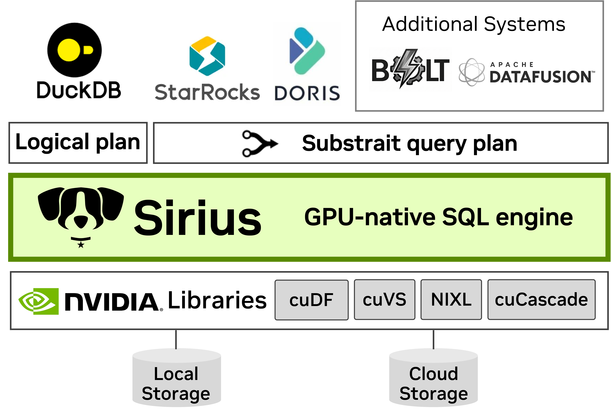
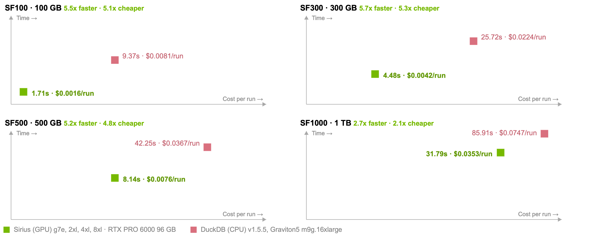

<p align="center">
  <picture>
    <source media="(prefers-color-scheme: dark)" srcset="logo/sirius_dark_full.svg">
    <source media="(prefers-color-scheme: light)" srcset="logo/sirius_light_full.svg">
    
  </picture>
  <br/>
  <a href="https://join.slack.com/t/sirius-db/shared_invite/zt-33tuwt1sk-aa2dk0EU_dNjklSjIGW3vg">
    
  </a>
</p>

Sirius is a GPU-native SQL engine. It plugs into existing databases via the standard Substrait query format, requiring no query rewrites or major system changes. Sirius currently supports DuckDB and Starrocks (coming soon), other systems marked with \* are on our roadmap. Built on NVIDIA CUDA-X libraries including cuDF, cuVS, and cuCascade, Sirius delivers high-performance GPU-accelerated analytics.

<p align="center">
  
</p>

## Concurrent queries

Use separate connections to one DuckDB DatabaseInstance and set startup
`sirius.max_concurrent_queries` (default 1). See the [concurrent-query guide](super-sirius/concurrent-queries.md)
for admission, maintenance, cancellation, memory pressure and qualification scope.

## Performance

TPC-H hot runs on AWS, 22 queries · best Sirius g7e size vs DuckDB on m9g.16xlarge · cost per run, log scales · lower left is better.



For the legacy Sirius implementation used for the ClickBench results, see the
[`legacy-dev` archive (pinned at `f79a6f42`)](https://github.com/sirius-db/sirius/tree/f79a6f423fe69ef892ca0af03bef9c352d88cc79).

## Requirements
- Linux on amd64/x86_64 or arm64/aarch64 with `glibc >= 2.28`.
- NVIDIA Turing or newer, with compute capability 7.5+.
- CUDA 13.x (driver 580.65.06 or newer) or CUDA 12.x (driver 570.26 or newer).
- `io_uring` enabled at runtime (`CONFIG_IO_URING`, `kernel.io_uring_disabled=0` recommended). Containers must allow `io_uring_setup`, `io_uring_enter`, and `io_uring_register`.
- Local Parquet files should be on a filesystem/block device that supports direct I/O (`O_DIRECT`).

## Using Sirius as a DuckDB Extension

Sirius is available as a DuckDB core extension since **DuckDB v2.0.1**, on Linux (`linux_amd64` and `linux_arm64`). This is the quickest way to try Sirius: install and load it from any DuckDB client.

```sql
INSTALL sirius;
LOAD sirius;
```

`LOAD sirius` picks the Sirius backend that matches your NVIDIA driver (CUDA 12 or CUDA 13) and downloads it on first use. Once it's loaded, supported queries run on the GPU with no query changes. For details on backends, CPU fallback, updating and settings, see the [Sirius extension page](https://duckdb.org/docs/2.0/core_extensions/sirius) in the DuckDB documentation.

## Installing a Prebuilt Sirius Release

Prebuilt Sirius extensions are also published as GitHub releases, which you can use without building from source:

- [`stable`](https://github.com/sirius-db/sirius/releases/tag/stable): a maintainer-selected build, promoted manually
- [`latest`](https://github.com/sirius-db/sirius/releases/tag/latest): tracks the newest successful build on `main` automatically, possible to encounter breaking changes

Both include full install instructions in the release notes: installing a matching DuckDB
version, downloading the right binary for your platform, and a sample query to try it with.

## Building Sirius from Source

Build from source to use the latest code on `main`, make changes to Sirius, or run its tests. For full build instructions, alternate build types, pre-commit setup, and testing, see [DEVELOPMENT.md](DEVELOPMENT.md).

### Build Requirements

- Git (to clone the repo)
- Pixi (install instructions [here](https://pixi.sh/latest/installation/))

### Quick Start

```bash
git clone --no-recurse-submodules https://github.com/sirius-db/sirius.git
cd sirius
git submodule update --init --depth=1 --jobs 5 duckdb substrait cucascade sirius-duckdb/duckdb sirius-duckdb/extension-ci-tools
pixi run make TEST_BUILD_TARGET=
pixi run duckdb
```

Alternatively, load the extension into an existing DuckDB shell:

```sql
LOAD 'sirius-duckdb/build/release/extension/sirius/sirius.duckdb_extension';
```

Either way, all DuckDB queries are automatically intercepted by the optimizer hook and run on GPU — no query rewrites required. Queries with unsupported operators fall back silently to CPU.

```sql
-- Load the TPC-H extension and generate data (scale factor 10 = ~10 GB)
INSTALL tpch;
LOAD tpch;
CALL dbgen(sf=10);

-- Plain SQL runs on GPU automatically
SELECT l_returnflag, sum(l_quantity)
FROM lineitem
GROUP BY l_returnflag
ORDER BY l_returnflag;

-- TPC-H data is exported as Parquet for use in later examples
COPY lineitem TO '/path/to/lineitem.parquet' (FORMAT PARQUET);

-- Disable transparent GPU execution for this connection
SET gpu_execution = false;
-- ... or for every connection of this database instance without a session value
SET GLOBAL gpu_execution = false;
```

Execution is out-of-core with tiered memory management (GPU/host/disk), automatic data partitioning, and spilling, and works with both **Parquet** and **DuckDB-native** storage. See [`gpu_execution`](gpu_execution.md) for build, configuration, and testing details.

### Which mode do I need?

| You have | Run | Notes |
|---|---|---|
| One machine with one or more GPUs | `pixi run duckdb` | Sirius uses every visible GPU in one process (`topology.num_gpus: all` is the default) |
| Several machines with GPUs | The distributed gateway: see the [distributed quick start](super-sirius/distributed-quickstart.md) | One SQL endpoint; each statement runs on one process per GPU across the machines |

Through the gateway, a query that Sirius cannot run fails; it does not fall back to the CPU.

## Python API

Use Sirius through DuckDB's Python API: load the extension, execute SQL, and fetch results.
Supported queries run on the GPU automatically, just as they do in the DuckDB shell.

Sirius supports one active engine context per process; this is not enforced at runtime.
Connections to the same DuckDB database instance share that context.
Close all connections to the first database instance and release any objects that
keep it alive before creating another instance. See the [Context API documentation](../include/sirius/context/context.hpp)
for process-wide configuration and lifetime restrictions.

The v2 extension requires the exact DuckDB revision pinned in this repository.
Python use requires a package built from that matching revision. The DuckDB Python
package in [`pixi.toml`](../pixi.toml) is intended for fixtures and data generation;
its version number alone does not establish extension compatibility. Use the built
CLI above if a matching Python client is unavailable.

Save this example as `example.py` in the repository root and replace `/path/to/lineitem.parquet`
with your TPC-H Parquet file. `allow_unsigned_extensions` allows loading the locally built
extension.

```python
import duckdb

con = duckdb.connect(":memory:", config={"allow_unsigned_extensions": "true"})
con.execute("""
    CREATE VIEW lineitem AS
    SELECT * FROM read_parquet('/path/to/lineitem.parquet')
""")

con.execute("LOAD 'sirius-duckdb/build/release/extension/sirius/sirius.duckdb_extension'")
rows = con.execute("""
    SELECT l_returnflag, SUM(l_quantity) AS total_quantity
    FROM lineitem
    GROUP BY l_returnflag
    ORDER BY l_returnflag
""").fetchall()

print(rows)
con.close()
```

Run it from the repository root with a Python client built from the matching DuckDB
revision. If that client is installed in your Pixi environment, use:

```bash
pixi run python example.py
```

For an example using TPC-H data from Parquet files or a DuckDB database, see the
[Python benchmark script](../test/tpch_performance/performance_test.py).

The Python benchmark and power/throughput runners require a Python DuckDB client
built from the pinned v2 revision, as described above. The CLI-based scripts use
the built v2 host.

## Pinning Tables for Hot Runs

Sirius reads table data from storage on every query. For the best hot-run performance, pin
frequently queried tables: `pin_table` materializes a table's columns into memory once, and
subsequent queries over that source are served straight from the pinned copy, skipping file
I/O and decode entirely. Queries don't change — pinned tables are matched automatically.

```sql
-- Pin a parquet file (or glob) into GPU memory; omit cols to pin all columns
CALL pin_table('/path/to/lineitem.parquet', name = 'lineitem', tier = 'gpu',
               cols = ['l_orderkey', 'l_quantity', 'l_extendedprice', 'l_shipdate']);

-- Pin a DuckDB base table
CALL pin_table(format = 'duckdb', name = 'my_table', tier = 'gpu');

-- Served from the pinned copy — no file I/O
SELECT sum(l_extendedprice * l_quantity)
FROM read_parquet('/path/to/lineitem.parquet')
WHERE l_shipdate >= DATE '1994-01-01';

-- Release the pinned memory
CALL unpin_table('lineitem');
```

`tier = 'gpu'` pins columns in GPU memory for the fastest scans; `tier = 'host'` pins them in
pinned host memory instead, for tables larger than GPU memory.

Deletes and committed inserts on pinned DuckDB tables are reconciled per query. `UPDATE`,
`MERGE ... UPDATE`, and `INSERT ... ON CONFLICT DO UPDATE` are rejected while the target table is
pinned; run `CALL unpin_table(...)` before updating it. An explicit `CHECKPOINT` while a pin is
live makes that pin ineligible to serve: subsequent queries fall back or error until the table is
unpinned and pinned again.

### Compression with Simpatico

Sirius attempts Simpatico compression by default when pinning data in GPU or host memory.
Without a plan file, it automatically chooses a plan for each column in each chunk. Use
`compression => false` on a pin call, or `SET pin_table_compression = false`, to opt out.

Table plan files are optional overrides. This example runs from the repository root and uses
the bundled TPC-H SF1000 plans instead of automatic selection:

```sql
SET pin_table_compression = true;
SET pin_table_input_compression_plan_dir = 'src/compression/simpatico_codegen/plans/tpch_sf1000';

CALL pin_table('/path/to/lineitem.parquet', name = 'lineitem', tier = 'gpu',
               cols = ['l_returnflag', 'l_quantity']);

-- Normal SQL reads the compressed pinned data automatically
SELECT l_returnflag, SUM(l_quantity) AS total_quantity
FROM read_parquet('/path/to/lineitem.parquet')
GROUP BY l_returnflag
ORDER BY l_returnflag;

CALL unpin_table('lineitem');
```

Use `tier = 'host'` to pin compressed data in host memory. To override automatic selection for
other datasets, point the plan directory at plans matching your table schemas. A plan file
must match the pinned table's `name` (for example, `lineitem.txt`) and contain one column plan
per full-table column in schema order. Without a readable, nonempty matching file, selection
remains automatic. A selected file that does not cover the requested columns leaves the pin
uncompressed, as do small chunks, insufficient savings, and recoverable encoding failures.

Each pin call reads the calling session's plan settings; no process restart is needed to
change a plan. A compressed GPU result replaces the previous entry when pinned again. A raw
GPU result can merge compatible raw columns, or replace a previous compressed GPU entry.
Pin the complete intended column set together when compression is enabled. See the guide
below for merge requirements and explicit-plan staging limits.

From Python, execute the same SQL with `con.execute(...)` after loading the extension and before
querying. See the [compressed pinning guide](super-sirius/compressed-pinning.md) for plan selection
and tuning.

## Configuration

Sirius loads its settings from a YAML config file, searched in this order:

1. Path in the `SIRIUS_CONFIG_FILE` environment variable
2. `./sirius.yaml` (current working directory)
3. `~/.sirius/sirius.yaml`

If no config file is found, built-in defaults apply (95% GPU memory, 8 GiB pinned host memory per NUMA node). See the [Configuration reference](super-sirius/configuration.md) for all options: memory tiers, thread pools, operator parameters, and runtime `SET` variables. An example config is provided at [`test/cpp/integration/integration.yaml`](../test/cpp/integration/integration.yaml).

## Disk Spilling

Disk spilling is disabled by default: `sirius.memory.disk.downgrade_root_dirs` is empty,
so there is no default spill directory. GPU data can still spill to host memory without
a disk tier.

To enable spilling from host memory to disk, add a spill directory on a fast local mount
(NVMe preferred) to your `sirius.yaml` before starting Sirius:

```yaml
sirius:
  memory:
    disk:
      downgrade_root_dirs: "/mnt/nvme/sirius-spill"
      capacity_bytes: 1Ti
```

Replace the path with a writable directory on your machine. `capacity_bytes` limits the
disk spill tier and defaults to 1 TiB; it must be greater than zero to enable the tier.
If your config is elsewhere, set `SIRIUS_CONFIG_FILE=/path/to/sirius.yaml` before loading
the extension. See the [disk memory configuration](super-sirius/configuration.md#disk-memory-siriusmemorydisk)
for all disk settings.

## Logging
Source builds log with [spdlog](https://github.com/gabime/spdlog) to `log/sirius_<date>.log`, relative to the current working directory, at level `info`.
Messages from the embedded cuCascade library (GPU peer-access setup, topology discovery, CUDA error reports, and its I/O layer where enabled) flow through the same sink, prefixed `[cucascade]`, and are filtered by the same log level.

The released `sirius_cuda12` and `sirius_cuda13` extensions write no files by default: they log through DuckDB's logger and leave Quent telemetry off. Read their logs with `CALL enable_logging(); SELECT * FROM duckdb_logs WHERE type = 'Sirius';`, or select file logging with `SET sirius_log_backend = 'spdlog'` or `SIRIUS_LOG_BACKEND=spdlog`. When a query falls back to the CPU, the banner printed on stdout includes the GPU error.

Log directory and level for the `spdlog` backend can be initialized via environment variables before loading the extension:
```bash
export SIRIUS_LOG_BACKEND=spdlog  # needed for the released extensions
export SIRIUS_LOG_DIR=/path/to/logs
export SIRIUS_LOG_LEVEL=trace
```

Both can also be configured at runtime via DuckDB's `SET` command:
```sql
SET sirius_log_dir = '/path/to/logs';
SET sirius_log_level = 'trace';
SET sirius_log_flush_seconds = 1;
```

## Tracing
> **Note:** Tracing is experimental and the telemetry schema may change.

Sirius instruments query execution with [Quent](https://github.com/rapidsai/quent), emitting
per-query traces of operator and pipeline activity that Quent can render
as an interactive browser timeline. Enable it in your YAML config file,

```yaml
sirius:
  telemetry:
    enable_quent: true
    output_directory: telemetry_data
```

run queries, then visualize:

```bash
pixi run quent   # serves Quent UI at http://localhost:8080
```

See the [Quent Telemetry guide](super-sirius/quent-telemetry.md) for the full setup details: enabling the
exporter, per-query labeling, generating telemetry (using a TPC-H helper), and visualization.

## Limitations

Sirius is under active development. Notable current limitations include:

- **Data Type Coverage:** Sirius currently supports commonly used data types including `INTEGER`, `BIGINT`, `FLOAT`, `DOUBLE`, `VARCHAR`, `DATE`, `TIMESTAMP`, and `DECIMAL`. We are actively working on supporting additional data types—such as nested types.
- **Operator Coverage:** At present, Sirius supports `FILTER`, `PROJECTION`, `JOIN` (Hash/Nested Loop/Delim), `GROUP-BY`, `ORDER-BY`, `AGGREGATION`, `TOP-N`, `LIMIT`, and `CTE`. We are working on adding more advanced operators such as `WINDOW` functions and `ASOF JOIN`.

- **DuckDB v2 regex rewrites:** Whole-input backreference replacements, including the ClickBench Q28 URL pattern, are rewritten to `regexp_extract(..., 'k')` and currently require CPU fallback instead of using the GPU regex implementation. Tracked in [#2146](https://github.com/sirius-db/sirius/issues/2146).

For a full list of current limitations and ongoing work, please refer to our [GitHub issues page](https://github.com/sirius-db/sirius/issues). Unsupported types and operators fall back to DuckDB CPU execution when fallback is enabled.

## Contributors and Partners

<p align="center">
  <picture>
    <source media="(prefers-color-scheme: dark)" srcset="logo/combined-logos.png">
    <source media="(prefers-color-scheme: light)" srcset="logo/combined-logos-light-transparent.png">
    
  </picture>
</p>

## Future Roadmap
Sirius is still under major development and we are working on adding more features to Sirius, such as more operators, data types, accelerating more engines, and many more.

Sirius always welcomes new contributors! If you are interested, check our [website](https://www.sirius-db.com/), reach out to our [email](mailto:siriusdb@cs.wisc.edu), or join our [slack channel](https://join.slack.com/t/sirius-db/shared_invite/zt-33tuwt1sk-aa2dk0EU_dNjklSjIGW3vg).

**Let's kickstart the GPU eras for Data Analytics!**
