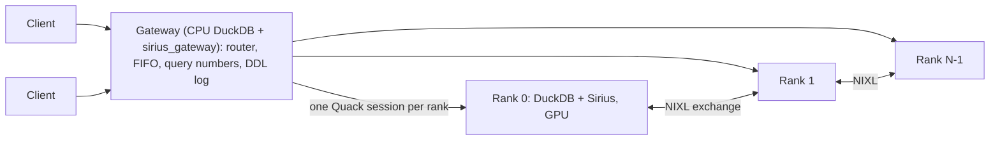

# Distributed gateway: one SQL endpoint for every rank

A [distributed query](distributed-sirius.md) needs every rank to run the same statements, in the
same order, with the same query numbers. The gateway does that for its clients. A client attaches
to one DuckDB endpoint over [Quack](https://duckdb.org/docs/2.0/quack/overview) and runs plain
SQL. The gateway sends each statement to every rank, one statement at a time, and returns rank 0's
result. The ranks still plan and execute; the gateway orders, numbers, guards and restarts them.



## Quick path

Build Sirius with `-DSIRIUS_WITH_NIXL=ON` ([Distributed Execution](distributed-sirius.md)), then
the gateway, a CPU-only DuckDB with `httpfs`, `quack` and `sirius_gateway`:

```bash
pixi run make -C gateway release
```

**One node.** The gateway starts one rank per GPU and serves clients on port 9494:

```bash
SIRIUS_GATEWAY_TOKEN=my_token pixi run scripts/sirius_gateway.sh 4
```

```sql
ATTACH 'quack:127.0.0.1:9494' AS sirius (TOKEN 'my_token');
CONNECT sirius;
CREATE VIEW lineitem AS FROM read_parquet('/data/tpch_sf1000/lineitem/*.parquet');
SELECT l_shipmode, count(*) FROM lineitem GROUP BY ALL;   -- every rank runs it; rank 0 answers
```

**Several nodes.** Start a gateway with no ranks of its own. `SIRIUS_GATEWAY_PRIORITY_NETWORKS`
picks the address it listens on, as StarRocks' `priority_networks` does, and
`SIRIUS_GATEWAY_MIN_RANKS` is how many ranks the first statement waits for:

```bash
SIRIUS_GATEWAY_PRIORITY_NETWORKS=10.87.140.0/24 SIRIUS_GATEWAY_MIN_RANKS=2 \
  pixi run scripts/sirius_gateway.sh 0 9494 /home/me/sirius_gateway
```

It writes its address, token and TLS fingerprint to `<log dir>/gateway.conf`. On each node, run one
rank per GPU under `scripts/sirius_rank_node.sh`, with a config file that sources it (see
`scripts/sirius_rank_node.conf.example`):

```bash
cat > rank0.conf <<'CONF'
gpu=0
quack_port=9500
exchange_port=27000
priority_networks=10.87.140.0/24   # listen address, and UCX_NET_DEVICES
nixl_prefix=$HOME/tools/nvda_nixl
ucx_tls=cuda_copy,cuda_ipc,tcp,self
source /home/me/sirius_gateway/gateway.conf
CONF
pixi run scripts/sirius_rank_node.sh --config rank0.conf
```

The script starts the rank again whenever it exits. Once the rank listens, it registers it with
the gateway, as one of its clients, and again after every start of the rank. The first client
statement then starts the registered ranks. Without a gateway in its config, the script prints
the `sirius_gateway_add_rank` call (also in `<dir>/add_rank.sql`) for the gateway's console.

`SIRIUS_GATEWAY_HOST`, or `SIRIUS_GATEWAY_PRIORITY_NETWORKS`, lets clients on other hosts reach
the gateway, which then serves TLS with a key pair kept in `<log dir>/tls`; it listens on
127.0.0.1 by default. `sirius_gateway.sh` can also start ranks on other hosts itself,
over SSH (`SIRIUS_GATEWAY_HOSTS`, `scripts/sirius_gateway_ssh_rank.sh`). Ranks that all run on
one host need `UCX_TLS=cuda_copy,cuda_ipc,tcp,self`, as `distributed_run_sql.sh` sets: left to
itself, UCX picks InfiniBand ports that GB200 hosts cannot connect through.

## How a statement runs

1. Quack hands every client statement to `sirius_gateway_route`, which rewrites it to
   `FROM sirius_gateway_run('<statement>')`, or keeps it on the gateway (see [Routing](#routing)).
2. The statement waits for its turn: the gateway runs one statement at a time, in arrival order
   across all clients, so every rank sees the same order.
3. It takes the next query number K and sends `SET sirius_distributed_query_id = K`, then the
   statement, to every rank in parallel. The ranks must run together: they wait on each other
   inside the exchanges.
4. When every rank is done it returns rank 0's result. A statement that succeeded on every rank
   and is not a `SELECT`, `EXPLAIN` or transaction statement is appended to the DDL log: DDL, but
   also `INSERT`, `COPY`, `SET`, `CALL`, `ATTACH`. Every entry runs again on restarted ranks.

The gateway holds one Quack session per rank, and every client's statements go through it:
Sirius runs a process's distributed queries on one connection only.

**Query numbers.** Exchange streams are numbered by query, so every rank must give a query the
same number. The gateway assigns K, strictly increasing for its whole life. A rank never plans
the numbers of statements that run no distributed query (`SET`, DDL); when it plans the next one,
it retires the numbers it skipped (`exchange_service::forget_range`). A prepared statement keeps
its own. K stays below 2^44, so a
stream id keeps every bit of it.

**Catalog reads**, SELECTs whose every table is a `duckdb_*()`, `pragma_*()` or
`sirius_rank_info()` function, like those Quack sends on every client's `ATTACH`, run on Sirius
ranks with `gpu_execution` off: Sirius cannot plan some of them, and fallback is off on every
rank.

## Routing

| Statement | Where it runs |
|---|---|
| Anything else | Every rank, through `sirius_gateway_run` |
| `BEGIN`, `COMMIT`, `ROLLBACK` | The client's own gateway session: one client's transaction never holds the others' statements. Each statement still commits on the ranks as it runs |
| `sirius_gateway_status()`, `sirius_gateway_log()` | The gateway |
| `SET` of a setting the gateway sets on each rank (`sirius_distributed_query_id`, `sirius_exchange_*`, `enable_duckdb_fallback`, `gpu_execution`) | Refused |
| `sirius_gateway_add_rank`, `sirius_gateway_drop_rank`, with `sirius_gateway_allow_remote_join` on (`sirius_gateway.sh` with 0 ranks sets it) | The gateway: a node registers its rank. A client's token already runs any SQL on every rank |
| Other `sirius_gateway_*`, `quack_*`, `sirius_rank_*` calls at a statement's top level (`CALL f()`, `FROM f()`, `SELECT f()`), and `SET` of such settings | Refused: gateway console only. Calls nested deeper are not checked |
| `PREPARE`, `EXECUTE` | Refused: a prepared plan keeps the query number it was planned with |

## Ranks

A rank is **spawned** or **registered**.

- `sirius_gateway_start(N)` spawns N ranks: local processes, or over SSH through
  `sirius_gateway_rank_launcher`. The gateway owns their processes and restarts them itself.
- `sirius_gateway_add_rank` registers a rank that a launcher started on its own node. Adding it
  waits for its turn, then connects to its Quack address, retrying for up to 10 s, so a wrong
  address, token or TLS fingerprint fails right away. Its exchange address is checked when the
  ranks next start.
  `sirius_gateway_drop_rank` unregisters it. Spawned ranks come first, then registered ones in
  the order they were added.

**Starting registered ranks.** Until `sirius_gateway_start` or `sirius_gateway_stop` is called,
a statement that finds no ranks running starts the registered ones itself, with the current
`sirius_gateway_*` settings, as `sirius_gateway_start(0)` would, then replays the DDL log. While
fewer than `sirius_gateway_min_ranks` (default 1) are registered, it fails instead of waiting,
since registering takes the same turn. While no ranks run, the gateway answers the catalog reads
a client's `ATTACH` sends from its own catalog, so attaching starts nothing and a node can attach
to register its rank. Without `sirius_gateway_min_ranks`, a rank registered after the first
statement restarts every rank. A start that fails is tried again by the next statement. After `sirius_gateway_stop`, only `sirius_gateway_start` or `sirius_gateway_restart`
starts ranks.

**Restart-to-join.** A rank's exchange peers are fixed once it connects, so every rank joins a
new set of ranks as a new process. A spawned rank is restarted by the gateway. A registered rank
is asked to exit: the gateway reads its boot id (`sirius_gateway_rank_boot_id_sql`, by default
`sirius_rank_info()`), and while the rank still runs the process the gateway last saw (at its last
join, or when it was added) it sends `sirius_gateway_rank_exit_sql` (by default
`CALL sirius_rank_exit()`) and waits up to 10 minutes for the launcher to start a new one. So even
a rank's first join restarts it. `sirius_rank_exit` replies, shuts the exchange down (freeing its port and
shared-memory mirrors) and exits with code 0; a watchdog ends it with code 1 if that hangs.

A change of members takes effect at a statement boundary: the cluster goes to `failed`, and the
next statement restarts every rank and replays the DDL log first. Every change therefore restarts
every rank.

**Addresses.** Peers reach a rank at its exchange address: for a registered rank, `exchange_host`,
or else the host of its Quack address. The gateway resolves it to an IPv4 address (NIXL takes only
numeric ones). An address in 127.0.0.0/8 next to other hosts' addresses is refused, so on a node
whose name resolves to 127.0.1.1 pass a routable `exchange_host` or listen host. A registered rank on a listen host other than loopback serves Quack over TLS with a key
pair its launcher keeps, and the gateway pins its fingerprint; it also raises `http_timeout` to a
day, since Quack's TLS client applies it to every call.

## Failures and cancellation

The gateway's state is `stopped`, `starting`, `ready` or `failed`. It is fail-stop: anything that
may leave the ranks out of step makes it `failed`, and the next statement restarts every rank
and replays the DDL log.

| Outcome of a statement | Result |
|---|---|
| A rank exited, could not be reached, or still ran at the end of the cancel ladder | `failed` |
| The exchange failed on a rank (its transport is gone for every later query) | `failed` |
| A state change that only some ranks made, cancelled or not | `failed` |
| A rank could not turn `gpu_execution` back on after a catalog read | `failed` |
| A DDL-log entry failed while it was replayed on restarted ranks | `failed`, naming the entry |
| Otherwise cancelled (client interrupt, `sirius_gateway_statement_timeout`) | Error; the ranks keep serving |
| A statement that failed on every rank | Error with the root cause: from the lowest failing rank, each "failed on rank R" is followed to the rank that blames no other. The ranks keep serving; nothing is logged |
| A read that failed on some ranks only | Error; the ranks keep serving, since every rank retired the query |

**Cancel ladder.** On a client interrupt or the statement timeout, no rank starts the next
statement in its list, and `quack_cancel` goes to each rank still running every 100 ms. After
`sirius_gateway_cancel_grace` the gateway kills the process of each spawned rank still running:
the rank itself, or for a rank on another host its SSH launcher, whose exit drops the forwarded
port (the rank then ends through the launcher's watchdog). Every rank still running at that
point, registered ones included, makes the cluster `failed`. A call still stuck 10 s later is
abandoned.

## SQL surface

| Function | What |
|---|---|
| `sirius_gateway_start(ranks, gpus :=, hosts :=, exchange_base_port :=, quack_base_port :=)` | Starts `ranks` spawned ranks plus the registered ones; clears the DDL log |
| `sirius_gateway_add_rank('host:port', exchange_port :=, token :=, fingerprint :=, name :=, exchange_host :=)` | Registers a rank started outside the gateway. `exchange_port` and `token` are required; `name` defaults to the address. Unless the cluster is stopped, every rank restarts at the next statement. The same rank again, with the same addresses and credentials, changes nothing |
| `sirius_gateway_drop_rank(name)` | Unregisters a registered rank, likewise |
| `sirius_gateway_restart()` | Restarts every rank and replays the DDL log |
| `sirius_gateway_stop()` | Stops spawned ranks and disconnects registered ones |
| `sirius_gateway_run(sql)` | Runs `sql` on every rank; what the router rewrites statements to |
| `sirius_gateway_status()` | One row per rank: process, name, state, cluster state and its reason, query numbers, queue |
| `sirius_gateway_log()` | The DDL log |
| `sirius_gateway_route(user, sql)` | Quack's authorization callback that routes each client statement: `SET GLOBAL quack_authorization_function = 'sirius_gateway_route'` |
| `sirius_gateway_test_signal(rank, signal)`, `sirius_gateway_test_serve(port, token, init)` | Test hooks |

On the ranks, Sirius adds `sirius_rank_info()` and `sirius_rank_exit()`
(`src/exchange/rank_control.cpp`).

| Setting | Default | What |
|---|---|---|
| `sirius_gateway_duckdb_binary` | | DuckDB that runs each spawned rank |
| `sirius_gateway_sirius_extension` | | Sirius extension the ranks load; empty runs CPU ranks, for tests |
| `sirius_gateway_rank_init` | | SQL each rank's session runs after the exchange settings |
| `sirius_gateway_rank_launcher` | | Program that starts a spawned rank on another host |
| `sirius_gateway_log_dir` | temporary | Rank init files and logs |
| `sirius_gateway_allow_remote_join` | false | Lets clients call `sirius_gateway_add_rank` and `sirius_gateway_drop_rank`, for nodes to register their ranks |
| `sirius_gateway_min_ranks` | 1 | Registered ranks the first statement waits for before it starts them; until then statements fail |
| `sirius_gateway_statement_timeout` | 3600 | Seconds before a statement is cancelled; 0 is none. A rank waiting on a peer that never ran the query has no bound of its own |
| `sirius_gateway_cancel_grace` | 30 | Seconds a cancelled statement may keep running before its ranks are killed |
| `sirius_gateway_rank_boot_id_sql` | `SELECT boot_id FROM sirius_rank_info()` | Names a registered rank's process |
| `sirius_gateway_rank_exit_sql` | `CALL sirius_rank_exit()` | Ends it, for its launcher to restart it |
| `sirius_gateway_query_id_setting` | `sirius_distributed_query_id` | Setting that carries K to each rank; empty sends none |

## Limits

- **One statement at a time** for the whole gateway, including the catalog reads of each
  client's `ATTACH`.
- **Shared rank sessions:** a client's `SET` reaches every client's statements, and is logged and
  replayed. `CREATE TABLE` and `INSERT` give one copy of the rows per rank. `now()` and `random()`
  evaluate on each rank. A `ROLLBACK` does not undo what ran on the ranks.
- **The router is a deny-list** over top-level statements: a gateway function nested in a subquery
  reaches the ranks.
- **In memory only:** the DDL log and the registered ranks are lost when the gateway restarts. A
  node registers its rank again only when the rank starts again: after restarting the gateway,
  restart the node scripts, or run each `<dir>/add_rank.sql` on its console.
- **No heartbeat:** an idle rank that dies is found by the next statement, and a frozen remote
  rank only by the statement timeout. The gateway cannot kill a registered rank; a cancel it
  ignores holds the gateway's turn for up to the grace period plus 15 s, and the cluster is then
  `failed`.
- **Joins run one rank at a time**, each waiting up to 10 minutes, and a registered rank whose
  launcher is gone fails every restart until it is dropped.
- **A cancel during planning** (the shape all-gather ignores interrupts) can escalate to killing
  the ranks.
- **CI:** nothing builds or tests `gateway/` automatically.

## Tests

On CPU ranks (plain DuckDB serving Quack, no Sirius), from `gateway/`:

```bash
build/release/test/unittest "test/sql/*"
```

| File | Covers |
|---|---|
| `sirius_gateway.test` | Fan-out, query numbers, DDL log and replay, concurrent clients, timeout, routing |
| `sirius_gateway_hosts.test` | Spawned ranks on other hosts through the rank launcher |
| `sirius_gateway_failstop.test` | Which outcomes fail the cluster, the root cause, a killed rank, the cancel ladder |
| `sirius_gateway_registry.test` | Adding, joining, restarting and dropping registered ranks, with stand-ins for `sirius_rank_info` and `sirius_rank_exit` |
| `sirius_gateway_autostart.test` | The first statement starting the registered ranks, `sirius_gateway_min_ranks`, a rank registered by a client, no start after a stop |

The query-number rules, and `sirius_rank_info`'s boot id, are unit-tested in
`test/cpp/exchange/test_exchange_query_windows.cpp` and `test_exchange_plan_reuse.cpp`. GPU runs are manual.

## Files

| Path | What |
|---|---|
| `gateway/src/statement_router.cpp` | Routing |
| `gateway/src/gateway_state.cpp` | FIFO turn, query numbers, fan-out and cancel ladder, outcomes, DDL log, registry, joins |
| `gateway/src/rank_supervisor.cpp` | Starting and ending spawned ranks |
| `gateway/src/sirius_gateway_extension.cpp` | SQL functions and settings |
| `scripts/sirius_gateway.sh` | Starts a gateway and its spawned ranks |
| `scripts/sirius_gateway_ssh_rank.sh` | Starts a spawned rank on another host over SSH |
| `scripts/sirius_rank_node.sh` | Runs a registered rank, restarts it when it exits, and registers it with the gateway |
| `scripts/sirius_rank_node.conf.example` | A node's config file |
| `scripts/sirius_net.sh` | Picks this host's address and interface in `priority_networks` |
| `src/exchange/rank_control.cpp` | `sirius_rank_info`, `sirius_rank_exit` |
