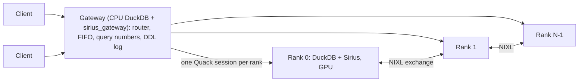

# Distributed gateway: one SQL endpoint for every rank

A [distributed query](distributed-sirius.md) needs every rank to run the same statements, in the
same order, with the same query numbers. The gateway does that for its clients. A client attaches
to one DuckDB endpoint over [Quack](https://duckdb.org/docs/2.0/quack/overview) and runs plain
SQL. The gateway sends each statement to every rank, one statement at a time, and returns rank 0's
result. The ranks still plan and execute; the gateway orders, numbers, guards and restarts them.



## Quick path

For several machines, follow the [distributed quick start](distributed-quickstart.md):
`pixi run build-distributed` on every machine, then `pixi run sirius-gateway`,
`pixi run sirius-node` on each GPU machine, and `pixi run sirius-client`.

**One machine.** The gateway can start its ranks itself, rank i on GPU i:

```bash
pixi run build-distributed     # Sirius with NIXL, and the gateway
pixi run sirius-gateway 4      # 4 ranks on this machine; serves clients on port 9494
pixi run sirius-client         # in another shell
```

```sql
CREATE VIEW lineitem AS FROM read_parquet('/data/tpch_sf1000/lineitem/*.parquet');
SELECT l_shipmode, count(*) FROM lineitem GROUP BY ALL;   -- every rank runs it; rank 0 answers
```

The gateway is a CPU-only DuckDB with `httpfs`, `quack` and `sirius_gateway`
(`make -C gateway release`, which `build-distributed` runs). `scripts/sirius_gateway.sh` writes
its address, token and TLS fingerprint to `~/.sirius/gateways/<cluster>/gateway.conf`, and
`sirius-client` attaches with them. Any DuckDB with `quack` can do the same:

```sql
SET GLOBAL http_timeout = 86400;   -- Quack's TLS client stops every call at http_timeout
ATTACH 'quack:127.0.0.1:9494' AS sirius (TOKEN '<gateway_token>');
-- with TLS: (TOKEN '<gateway_token>', SSL_FINGERPRINT '<gateway_fingerprint>')
CONNECT sirius;
```

**Several machines.** With no ranks of its own (the default), the gateway lets ranks register
themselves (`sirius_gateway_allow_join`). On each node, `scripts/sirius_node.sh` runs one rank
per GPU, each under `scripts/sirius_rank_node.sh`. That script starts the rank again whenever it
exits. Once the rank listens, it registers it with the gateway, as one of its clients
(`sirius_gateway_add_rank`), after every start of the rank, and again whenever `gateway.conf`
names a new `gateway_id`. Without a gateway, it prints the `sirius_gateway_add_rank` call (also
in `<dir>/add_rank.sql`) for the gateway's console. To run one rank yourself (systemd, tmux),
give `sirius_rank_node.sh` a config file; see `scripts/sirius_rank_node.conf.example`.

**Listen addresses.** The gateway listens on `SIRIUS_GATEWAY_HOST`, or on this host's first address in
`SIRIUS_GATEWAY_PRIORITY_NETWORKS` (CIDRs, as StarRocks' `priority_networks`). Otherwise it
listens on the address of the default route's interface with no ranks of its own, and on
127.0.0.1 with spawned ranks. On an address other than loopback it serves TLS with a key pair
kept in `~/.sirius/gateways/<cluster>/tls`. A registered rank listens on its node's first
address in its `priority_networks`, by default the gateway's subnet from `gateway.conf`, and
`UCX_NET_DEVICES` defaults to that address's interface. `scripts/nixl_env.sh` defaults
`UCX_TLS` to `cuda_copy,cuda_ipc,tcp,self`: left to itself, UCX picks InfiniBand ports that GB200
hosts cannot connect through.

## How a statement runs

1. Quack hands every client statement to `sirius_gateway_route`, which rewrites it to
   `FROM sirius_gateway_run('<statement>')`, or keeps it on the gateway (see [Routing](#routing)).
2. The statement waits for its turn: the gateway runs one statement at a time, in arrival order
   across all clients, so every rank sees the same order.
3. It takes the next query number K and sends `SET sirius_distributed_query_id = K`, then the
   statement, to every rank in parallel. The ranks must run together: they wait on each other
   inside the exchanges.
4. When every rank is done it returns rank 0's result. A statement that succeeded on every rank
   and is not a `SELECT`, `EXPLAIN` or transaction statement is appended to the DDL log: DDL, but
   also `INSERT`, `COPY`, `SET`, `CALL`, `ATTACH`. Every entry runs again on restarted ranks.

The gateway holds one Quack session per rank, and every client's statements go through it:
Sirius runs a process's distributed queries on one connection only.

**Query numbers.** Exchange streams are numbered by query, so every rank must give a query the
same number. The gateway assigns K, strictly increasing for its whole life. A rank never plans
the numbers of statements that run no distributed query (`SET`, DDL); when it plans the next one,
it retires the numbers it skipped (`exchange_service::forget_range`). A prepared statement keeps
its own. K stays below 2^44, so a
stream id keeps every bit of it.

**Catalog reads**, SELECTs whose every table is a `duckdb_*()`, `pragma_*()` or
`sirius_rank_info()` function, like those Quack sends on every client's `ATTACH`, run on Sirius
ranks with `gpu_execution` off: Sirius cannot plan some of them, and fallback is off on every
rank.

## Routing

| Statement | Where it runs |
|---|---|
| Anything else | Every rank, through `sirius_gateway_run` |
| `BEGIN`, `COMMIT`, `ROLLBACK` | The client's own gateway session: one client's transaction never holds the others' statements. Each statement still commits on the ranks as it runs |
| `sirius_gateway_status()`, `sirius_gateway_log()` | The gateway |
| `SET` of a setting the gateway sets on each rank (`sirius_distributed_query_id`, `sirius_exchange_*`, `enable_duckdb_fallback`, `gpu_execution`) | Refused |
| `sirius_gateway_add_rank`, `sirius_gateway_drop_rank`, with `sirius_gateway_allow_join` on (`sirius_gateway.sh` with 0 ranks sets it) | The gateway: a node registers its rank. A client's token already runs any SQL on every rank |
| Other `sirius_gateway_*`, `quack_*`, `sirius_rank_*` calls at a statement's top level (`CALL f()`, `FROM f()`, `SELECT f()`), and `SET` of such settings | Refused: gateway console only. Calls nested deeper are not checked |
| `PREPARE`, `EXECUTE` | Refused: a prepared plan keeps the query number it was planned with |

## Ranks

A rank is **spawned** or **registered**.

- `sirius_gateway_start(N)` spawns N ranks, processes on the gateway's host. The gateway owns
  their processes and restarts them itself. A spawned rank inherits none of the gateway's open
  files beyond stdin, stdout and stderr, so a rank that outlives the gateway does not hold the
  launch script's lock.
- `sirius_gateway_add_rank` registers a rank that a launcher started on its own node. Adding it
  waits for its turn, then connects to its Quack address, retrying for up to 10 s, so a wrong
  address, token or TLS fingerprint fails right away. That probe also records the process's boot
  id. Its exchange address is checked when the ranks next start. Adding the same rank again, with
  the same addresses and credentials, does nothing, and does not wait for the turn. A different
  rank under a name already registered replaces it, once its probe succeeds.
  `sirius_gateway_drop_rank` unregisters it.

Spawned ranks come first, then registered ones ordered by name (by default the Quack address,
`host:port`), so which rank is rank 0 does not depend on the order the nodes registered in.

**Starting registered ranks.** Until `sirius_gateway_start` or `sirius_gateway_stop` is called,
a statement that finds no ranks running starts the registered ones itself, with the current
`sirius_gateway_*` settings, as `sirius_gateway_start(0)` would, then replays the DDL log. While
fewer than `sirius_gateway_min_ranks` (default 1) are registered, the statement first waits for
them, without holding the turn, for up to `sirius_gateway_join_wait` seconds (default 600; 0
fails at once; at most a year). Meanwhile `sirius_gateway_status()` says "waiting for N ranks
(sirius_gateway_min_ranks); M are registered". A client interrupt ends the wait. If too few have
registered by then, the statement fails. While no ranks run, the gateway answers the catalog
reads a client's `ATTACH` sends from its own catalog, so attaching neither waits nor starts
anything, and a node can attach to register its rank. A rank registered after the first
statement restarts every rank. A start that fails is tried again by the next statement. After
`sirius_gateway_stop`, only `sirius_gateway_start` or `sirius_gateway_restart` starts ranks.

**Restart-to-join.** A rank's exchange peers are fixed once it connects, so a rank process joins
one set of ranks only. A spawned rank is restarted by the gateway. For a registered rank, the
gateway reads its boot id (`sirius_gateway_rank_boot_id_sql`, by default `sirius_rank_info()`).
While the rank still runs the process the gateway last saw (at its last join, or when it was
added), the gateway asks whether that process has joined (`sirius_gateway_rank_joined_sql`, by
default `SELECT joined FROM sirius_rank_info()`). A process that has never joined is used as it
is. One that has joined is sent `sirius_gateway_rank_exit_sql` (by default
`CALL sirius_rank_exit()`), and the gateway waits up to 10 minutes for the launcher to start a
new one. An empty `sirius_gateway_rank_joined_sql` counts every process as joined. So a rank's
first join uses the process that registered, and each later join restarts it.
`sirius_rank_exit` replies, shuts the exchange down (freeing its port and shared-memory mirrors)
and exits with code 0; a watchdog ends it with code 1 if that hangs.

Joins run in parallel. The first join that fails ends the others' retries, and its error is the
one reported.

A change of members takes effect at a statement boundary: the cluster goes to `failed`, and the
next statement restarts every rank and replays the DDL log first. Every change therefore restarts
every rank.

**Addresses.** Peers reach a rank at its exchange address: for a registered rank, `exchange_host`,
or else the host of its Quack address. The gateway resolves it to an IPv4 address (NIXL takes only
numeric ones). An address in 127.0.0.0/8 next to other hosts' addresses is refused, so on a node
whose name resolves to 127.0.1.1 pass a routable `exchange_host` or listen host. A registered rank on a listen host other than loopback serves Quack over TLS with a key
pair its launcher keeps, and the gateway pins its fingerprint; it also raises `http_timeout` to a
day, since Quack's TLS client applies it to every call.

## Failures and cancellation

The gateway's state is `stopped`, `starting`, `ready` or `failed`. It is fail-stop: anything that
may leave the ranks out of step makes it `failed`, and the next statement restarts every rank
and replays the DDL log.

| Outcome of a statement | Result |
|---|---|
| Before the statement: a registered rank's Quack port took no connection within 2 s | `failed`; this statement restarts every rank and replays the DDL log, then runs |
| A rank exited, could not be reached, or still ran at the end of the cancel ladder | `failed` |
| The exchange failed on a rank (its transport is gone for every later query) | `failed` |
| A state change that only some ranks made, cancelled or not | `failed` |
| A rank could not turn `gpu_execution` back on after a catalog read | `failed` |
| A DDL-log entry failed while it was replayed on restarted ranks | `failed`, naming the entry. Except for the saved log that a fresh gateway replays: see [Limits](#limits) |
| Otherwise cancelled (client interrupt, `sirius_gateway_statement_timeout`) | Error; the ranks keep serving |
| A statement that failed on every rank | Error with the root cause: from the lowest failing rank, each "failed on rank R" is followed to the rank that blames no other. The ranks keep serving; nothing is logged |
| A read that failed on some ranks only | Error; the ranks keep serving, since every rank retired the query |

**Cancel ladder.** On a client interrupt or the statement timeout, no rank starts the next
statement in its list, and `quack_cancel` goes to each rank still running every 100 ms. After
`sirius_gateway_cancel_grace` the gateway kills each spawned rank still running; it cannot kill
a registered one. Every rank still running at that point, registered ones included, makes the
cluster `failed`. A call still stuck 10 s later is
abandoned.

## SQL surface

| Function | What |
|---|---|
| `sirius_gateway_start(ranks, gpus :=, exchange_base_port :=, quack_base_port :=, replay_saved :=)` | Starts `ranks` spawned ranks on this host plus the registered ones. It clears the DDL log, and deletes `<state_dir>/ddl.sql` once the new ranks run. With `replay_saved := true` it keeps the log instead, and replays `ddl.sql` on the new ranks, as a restarted gateway's first start does; `sirius_gateway.sh` with N > 0 ranks uses it |
| `sirius_gateway_add_rank('host:port', exchange_port :=, token :=, fingerprint :=, name :=, exchange_host :=)` | Registers a rank started outside the gateway. `exchange_port` and `token` are required; `name` defaults to the address. Unless the cluster is stopped, every rank restarts at the next statement. The same rank again, with the same addresses and credentials, changes nothing; another under the same name replaces it |
| `sirius_gateway_drop_rank(name)` | Unregisters a registered rank, likewise |
| `sirius_gateway_restart()` | Restarts every rank and replays the DDL log |
| `sirius_gateway_stop()` | Stops spawned ranks and disconnects registered ones |
| `sirius_gateway_run(sql)` | Runs `sql` on every rank; what the router rewrites statements to |
| `sirius_gateway_status()` | One row per rank: process, name, state, cluster state and its `error` (why it is stopped or failed, what it waits for, or a note while it is `ready`: a skipped saved entry, or a log it could not save), `last_error` (the rank's last failure to join, to answer, or to keep running), query numbers, queue |
| `sirius_gateway_log()` | The DDL log |
| `sirius_gateway_route(user, sql)` | Quack's authorization callback that routes each client statement: `SET GLOBAL quack_authorization_function = 'sirius_gateway_route'` |
| `sirius_gateway_test_signal(rank, signal)`, `sirius_gateway_test_serve(port, token, init)` | Test hooks |

On the ranks, Sirius adds `sirius_rank_info()`, which returns the process's `pid`, its
`boot_id`, and whether its exchange has `joined` its peers, and `sirius_rank_exit()`
(`src/exchange/rank_control.cpp`).

| Setting | Default | What |
|---|---|---|
| `sirius_gateway_duckdb_binary` | | DuckDB that runs each spawned rank |
| `sirius_gateway_sirius_extension` | | Sirius extension the ranks load; empty runs CPU ranks, for tests |
| `sirius_gateway_rank_init` | | SQL each rank's session runs after the exchange settings, so it cannot change them |
| `sirius_gateway_exchange_host_staging` | `auto` | `sirius_exchange_host_staging` for every rank: `auto` (TCP lanes to ranks on other hosts), `always`, `never` or `remote` |
| `sirius_gateway_exchange_tcp_lanes` | 0 | `sirius_exchange_tcp_lanes` for every rank, at most 64; 0 shares 16 lanes among the ranks of a host |
| `sirius_gateway_exchange_mnnvl` | `auto` | `sirius_exchange_mnnvl` for every rank: `auto`, `require` or `off` put the rings in fabric memory, for NVLink between nodes |
| `sirius_gateway_exchange_frame_bytes` | 16777216 | `sirius_exchange_frame_bytes` for every rank |
| `sirius_gateway_exchange_send_frames` | 32 | `sirius_exchange_send_frames` for every rank |
| `sirius_gateway_exchange_recv_frames_per_peer` | 16 | `sirius_exchange_recv_frames_per_peer` for every rank; over TCP lanes, one frame in flight per lane |
| `sirius_gateway_log_dir` | temporary | Rank init files and logs |
| `sirius_gateway_allow_join` | false | Lets clients call `sirius_gateway_add_rank` and `sirius_gateway_drop_rank`, for nodes to register their ranks |
| `sirius_gateway_min_ranks` | 1 | Registered ranks the first statement waits for before it starts them |
| `sirius_gateway_join_wait` | 600 | Seconds a statement waits for `sirius_gateway_min_ranks` ranks to register before it fails; 0 fails at once. Capped at one year |
| `sirius_gateway_state_dir` | | Directory for `ddl.sql`, the DDL log kept across the gateway's restarts; empty keeps it in memory only. `sirius_gateway.sh` sets `~/.sirius/gateways/<cluster>` |
| `sirius_gateway_statement_timeout` | 3600 | Seconds before a statement is cancelled; 0 is none. A rank waiting on a peer that never ran the query has no bound of its own |
| `sirius_gateway_cancel_grace` | 30 | Seconds a cancelled statement may keep running before its ranks are killed |
| `sirius_gateway_rank_boot_id_sql` | `SELECT boot_id FROM sirius_rank_info()` | Names a registered rank's process |
| `sirius_gateway_rank_joined_sql` | `SELECT joined FROM sirius_rank_info()` | Says whether that process has joined a set of ranks, so must restart to join another; empty restarts it every time |
| `sirius_gateway_rank_exit_sql` | `CALL sirius_rank_exit()` | Ends it, for its launcher to restart it |
| `sirius_gateway_query_id_setting` | `sirius_distributed_query_id` | Setting that carries K to each rank; empty sends none |

## Limits

- **One statement at a time** for the whole gateway, including the catalog reads of each
  client's `ATTACH`.
- **Shared rank sessions:** a client's `SET` reaches every client's statements, and is logged and
  replayed. `CREATE TABLE` and `INSERT` give one copy of the rows per rank. `now()` and `random()`
  evaluate on each rank. A `ROLLBACK` does not undo what ran on the ranks.
- **The router is a deny-list** over top-level statements: a gateway function nested in a subquery
  reaches the ranks.
- **State across gateway restarts:** with `sirius_gateway_state_dir` set (`sirius_gateway.sh`
  sets it), the DDL log is also written to `<state_dir>/ddl.sql`, mode 600, after each statement
  that adds to it. If that write fails, the statement still succeeds, and the status `error`
  column says "cannot save the DDL log: ..." while the cluster stays `ready`. A gateway that
  restarts replays the file when it first starts the ranks. Statements that carry credentials
  are not written: `CREATE SECRET`, a `SET` of a setting whose name contains `secret`, `token`,
  `password`, `key_id`, `access_key`, `connection_string` or `credential`, and an `ATTACH` with
  such an option. After a restart, run them again, or set them in `sirius_gateway_rank_init`,
  which every rank's session runs before the replay.
- **Skipped saved entries:** when a fresh gateway replays `ddl.sql`, an entry that fails alike on
  every rank (a file deleted since, a secret that is not there) is skipped rather than failing
  the cluster. The cluster still becomes `ready`, the status `error` column says "skipped saved
  DDL entry N: ...", and the entry is dropped from `ddl.sql`. So a saved view that needs a secret
  is skipped when the secret is missing at replay: create the view again after the secret.
  Replaying the in-memory log on restarted ranks is still fail-stop.
- **Registered ranks** are kept in memory only: nodes register them again when `gateway.conf`
  names a new `gateway_id`, which `sirius_gateway.sh` writes at each start. A node given
  `gateway` and `gateway_token` instead of `gateway_conf` registers again only when its rank
  restarts: restart its script, or run its `<dir>/add_rank.sql` on the gateway's console.
- **Dead ranks:** a spawned rank that exits is found by its process. Before each statement, while
  the ranks are ready, the gateway probes every registered rank's Quack port in parallel, for up
  to 2 s; a port that takes no connection makes it restart every rank and replay the DDL log
  before the statement runs. The probe only checks that the port takes a TCP connection. It
  misses a rank that hangs with its port open, which only the statement timeout finds, and a rank
  that its launcher has already started again on the same port. The gateway cannot kill a
  registered rank; a cancel it ignores holds the gateway's turn for up to the grace period plus
  15 s, and the cluster is then `failed`.
- **Joins** wait up to 10 minutes each, and a registered rank whose launcher is gone fails every
  restart until it is dropped.
- **A cancel during planning** (the shape all-gather ignores interrupts) can escalate to killing
  the ranks.
- **CI:** nothing builds or tests `gateway/` automatically.

## Tests

On CPU ranks (plain DuckDB serving Quack, no Sirius), from `gateway/`:

```bash
build/release/test/unittest "test/sql/*"
```

| File | Covers |
|---|---|
| `sirius_gateway.test` | Fan-out, query numbers, DDL log and replay, concurrent clients, timeout, routing |
| `sirius_gateway_failstop.test` | Which outcomes fail the cluster, the root cause, a killed rank, the cancel ladder |
| `sirius_gateway_registry.test` | Adding, joining, restarting, replacing and dropping registered ranks, ordered by name, with stand-ins for `sirius_rank_info` and `sirius_rank_exit` |
| `sirius_gateway_join.test` | A process that never joined serves as it is; one that has joined restarts; a registered rank that died between statements restarts the ranks before the next one |
| `sirius_gateway_state.test` | The DDL log in `sirius_gateway_state_dir`, without credential statements, replayed by a gateway that restarted; `sirius_gateway_start` clearing it |
| `sirius_gateway_replay.test` | A saved entry that fails on replay skipped and dropped; `replay_saved := true`; a state dir the gateway cannot write |
| `sirius_gateway_autostart.test` | The first statement starting the registered ranks, `sirius_gateway_min_ranks` and `sirius_gateway_join_wait`, a rank registered by a client while a statement waits, no start after a stop |

The query-number rules, and `sirius_rank_info`'s boot id and `joined`, are unit-tested in
`test/cpp/exchange/test_exchange_query_windows.cpp` and `test_exchange_plan_reuse.cpp`. GPU runs are manual.

## Files

| Path | What |
|---|---|
| `gateway/src/statement_router.cpp` | Routing |
| `gateway/src/gateway_state.cpp` | FIFO turn, query numbers, fan-out and cancel ladder, outcomes, DDL log and its file, registry, joins, the wait for ranks |
| `gateway/src/rank_supervisor.cpp` | Starting and ending spawned ranks; the port probe |
| `gateway/src/sirius_gateway_extension.cpp` | SQL functions and settings |
| `scripts/sirius_gateway.sh` | Starts a gateway (`pixi run sirius-gateway`), and its spawned ranks if asked; writes `~/.sirius/gateways/<cluster>/` |
| `scripts/sirius_node.sh` | Runs one registered rank per GPU on a node (`pixi run sirius-node`); `--check` checks the node |
| `scripts/sirius_client.sh` | A DuckDB shell attached to the gateway (`pixi run sirius-client`), through `~/.sirius/gateways/<cluster>/client.init.sql` (mode 600, with the token) |
| `scripts/sirius_slurm.sbatch` | A gateway and one rank per task in a Slurm job |
| `scripts/sirius_distributed_config.py` | Reads `sirius.distributed` from `sirius.yaml` for the scripts |
| `scripts/sirius_rank_node.sh` | Runs a registered rank, restarts it when it exits, and registers it with the gateway by feeding `<dir>/register.sql` (mode 600, with both tokens) to DuckDB on stdin |
| `scripts/sirius_rank_node.conf.example` | A config file for one rank; `sirius_node.sh` writes these |
| `scripts/sirius_net.sh` | Picks this host's address and interface in `priority_networks` |
| `src/exchange/rank_control.cpp` | `sirius_rank_info` (pid, boot id, joined), `sirius_rank_exit` |
