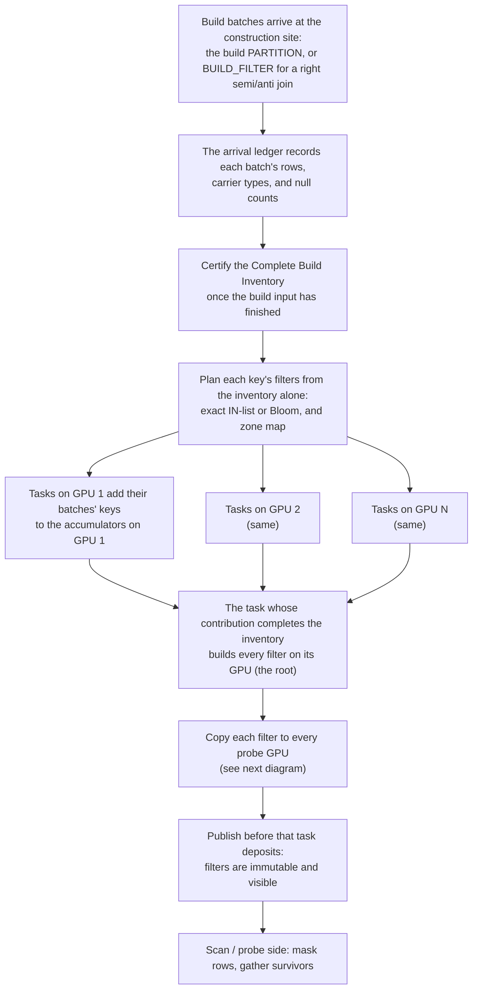
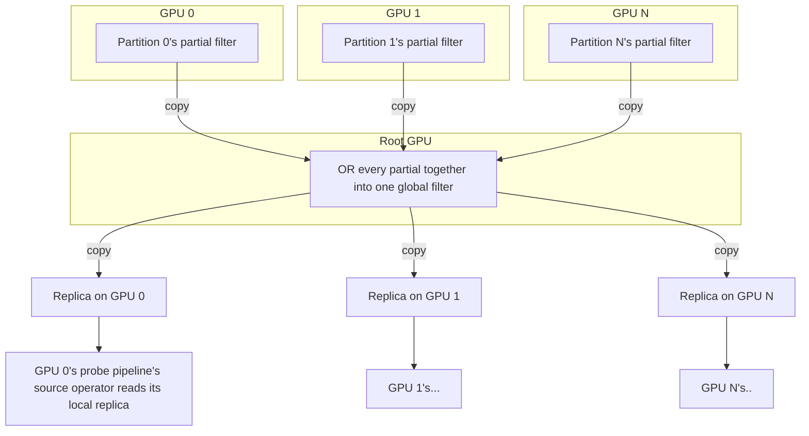
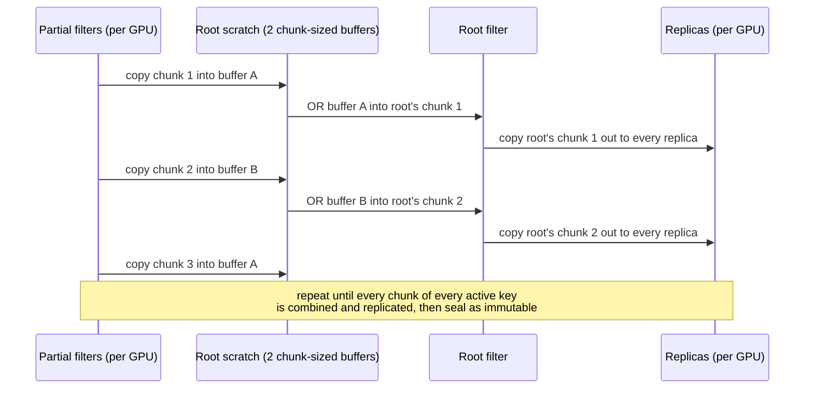
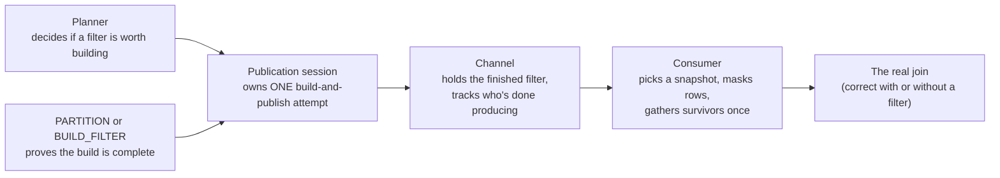

# Dynamic Filters for Hash Joins

This document describes the design for dynamic filters built from a hash join's complete build side, on every build layout. It is implemented in six layers plus S5b, which unifies filter construction (see "Landing this" at the bottom). Detailed evidence, exact commit hashes, and the PR-by-PR contract live in the [implementation plan](dynamic-filters-implementation-plan.md); the delivered behavior is described in [Dynamic Filters](dynamic-filters.md).

## The Core Mechanism

The construction site records every arriving batch and, once its input has finished, certifies the Complete Build Inventory: the exact batches, row counts, and per-column carrier types and null counts of the whole build. The inventory is the sole source of the facts that choose and size each key's filters, so every accumulator is sized for the whole build before the first batch contributes, and a key gets the filters a single batch of the same rows would get. Each task adds its batch's keys to three accumulators on its own GPU: a partial Bloom filter, a staging buffer of exact keys, and a min/max slot. The task whose contribution completes the inventory becomes the root. It merges the partial Bloom filters, gathers the staged exact keys and builds the IN-list, and merges the bounds into a zone map, building the IN-lists and zone maps under its own memory reservation and dropping any one that does not fit. It then copies each filter to every GPU that needs it and publishes before depositing its own output. The same mechanism runs on every build layout: hash-partitioned, single-partition, and broadcast.

## Combining Filters Across GPUs and Broadcasting the Result

There are up to N different partial Bloom filters sitting on N different GPUs. They must be **combined** into one filter that reflects the whole build side, and that one global filter needs to be **copied back out** to every GPU whose probe pipeline source will apply it. Below, the **Root GPU** is the GPU of the task whose contribution completes the inventory. Exact IN-lists and zone maps combine differently: every other GPU's staged keys are copied into the root's buffer and the root builds one list from the whole build's valid rows, and the per-batch bounds are merged on the host; the root then copies each finished filter to the other GPUs.

As an empricially verified optimizaiton, the actual copy-in/OR/copy-out work is pipelined in fixed-size chunks over two reusable scratch buffers, so peak transient memory stays bounded no matter how many GPUs or how big the filter is:

Buffer A and B alternate so that a chunk's copy-in can be issued concurrently with the previous chunk's copy-out. This pipelined strategy is chosen over a simpler serial baseline (copy one partial in, OR it, copy the result out, repeat — no overlap) that's used as a fallback when double-buffered scratch can't be reserved or fast GPU-to-GPU copies aren't available. Whether that fast copy path exists at all is itself gated by the cuCascade dependency (see below).

## Redesign: 3 Owners Instead of 1 Tangled Object

Currently, one object plays both "mutable thing being built" and "immutable thing being read," and "who's allowed to finish this filter" is a convention callers have to follow by hand. Later optimizations discovered in the optimization campaign (chunked GPU copies, a fused masking kernel, early scheduling, extra usefulness stats) had to bolt its own flag and bookkeeping onto that same semanticlaly confused core.

| Today (tangled) | Redesign (three pieces) |
| --- | --- |
| One filter object is both the mutable builder *and* the immutable published result | Builder is private inside the session; only a finished immutable filter is ever exposed |
| "Who may finish / fail / retry this filter" is an unenforced convention | The session is an explicit state machine: Open → Collecting → Publishing → Terminal |
| Producer completion tracked by anonymous counters — different readers can see different, disagreeing states | The channel tracks named producers; one `snapshot()` call always returns a single coherent view |
| Each optimization bolts its own selector flag/bookkeeping onto the shared core | Each optimization becomes a private implementation detail of the session or consumer — no new public surface |

**Publication session** — owns exactly one build-and-publish attempt for one join. Runs the mechanism above internally (plan → contribute → construct at the root → replicate → publish, or decline). Everything mutable — the accumulators and the combine strategy, held by `build_filter_construction` — lives privately inside it; the construction site owns the arrival ledger.

**Channel** — holds the finished, immutable filter for one join endpoint, plus whether every producer that could still add to it is done. Registrations are identified, not anonymous, so a snapshot can never be an inconsistent mix of half-updated state.

**Consumer** — lives on the scan/probe side. Takes one channel snapshot, builds a single mask-and-gather plan from it, applies it (fused kernel where supported, a fallback path otherwise), and gathers surviving rows exactly once. Records a receipt of what it applied so a later checkpoint doesn't reapply or re-measure the same filter.

## Other

### Getting the scan side started early (optional)

Normally the probe side waits until the build side finishes before doing any work. This design adds an *optional* extra condition: if the build's partition layout is locked in, every filter producer for that scan has finished, and there's spare memory to buffer the output, the scan can start reading and filtering early — buffering its output until the real hash table is ready. The actual join probe still waits for the real hash table; this only gives the scan a head start. It's purely additive: if the extra condition never fires, scheduling behaves exactly as it does today.

### The cuCascade dependency (H02)

CUDA peer access (the device-level "can GPU A see GPU B's memory", via `cudaDeviceEnablePeerAccess()`) is not the same as pool access (can GPU A read the *specific RMM pool* GPU B allocated from -- Sirius allocates from pools, not raw CUDA memory). `sirius_memory_reservation_manager` requests pool access for its ordinary RMM async pools through cuCascade's `grant_pool_peer_access` before installing cuDF resource references. cuCascade verifies bytes using private pools in both directions, then grants permission on each supplied pool; this neither probes actual Sirius allocations nor measures physical DMA. Sirius does not enable ordinary peer access or cache a device-pair capability: callers query their live source spaces through `try_grant_pool_access`. Unknown or unsupported capability stages replicas through HOST memory, including bounded HOST staging for Bloom publication; CUDA errors propagate. PR 4 below covers any additional allocation domains it introduces, implements bounded host-staged accumulated publication, and proves scratch, reservation, and retirement behavior. Topology and ingress performance claims require measurement.

## The PARTITION Total Row Count

To reduce the block between PARTITION's capture of the total row count and Bloom filter construction, something like PR 1765, which uses runtime estimation to size GROUP BY partitions, should be evaluated. Deferring to PR 6, as it is perf-exploratory by nature anyway.

### Landing this: six PRs plus S5b

1. Session + channel core (single build, no multi-partition support yet)
2. Multi-partition build → serial publication
3. Shared scan consumer + fused masking kernel
4. Complete accumulated publication transport and validation, on top of the pool access grants
5. Smarter "is this filter worth it" heuristics
6. Optional early probe-side start, and runtime row count estimation.

S5b, between PRs 5 and 6, unifies construction: every build PARTITION and BUILD_FILTER constructs every filter kind and key type from its Complete Build Inventory, as described above. It lands as three stacked PRs: additive construction pieces, the switch-over, and a filter-independent build-fold rule.

The stack targets `main`. PRs 5 and 6 follow PR 4. Each PR ships its own tests, docs, and config cleanup — there's no separate cleanup-only PR at the end.
