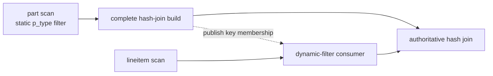
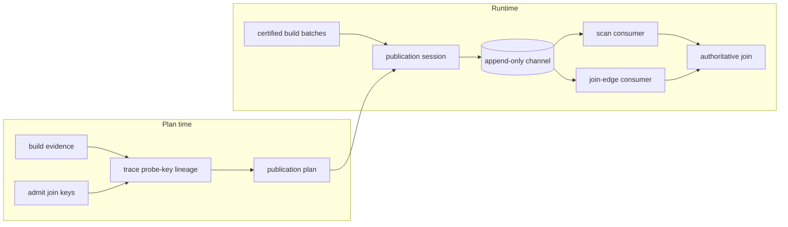

# Dynamic Filters

Terms are defined in the dynamic-filter glossary, [`src/op/dynamic_filter/GLOSSARY.md`](../../src/op/dynamic_filter/GLOSSARY.md).

A **dynamic filter** is a runtime predicate built by one operator and applied by another to avoid work. Sirius currently builds filters from an eligible hash join's complete build side and applies them to:

- a GPU scan reached through the join's probe subtree; or
- a join-edge endpoint placed inside that subtree when no scan can consume the key safely.

The implemented filter kinds are a raw IN-list, a hash IN-list (both exact for integer, temporal, and decimal keys, no false negatives for string keys), a Bloom filter, and an optional global min/max zone map. Membership filtering is enabled by `enable_dynamic_filter`; zone maps are separately opt-in.

Dynamic filters are optional for result correctness. They keep every row that could match the producing join, and the exact join remains authoritative. A missing, late, policy-gated, or device-unavailable filter therefore passes rows through safely.

## Example

Consider a plan that builds a hash join from the filtered `part` relation:

```sql
SELECT l.l_orderkey
FROM lineitem AS l
JOIN part AS p ON l.l_partkey = p.p_partkey
WHERE p.p_type = 'PROMO BRUSHED COPPER';
```

Once the complete `part` build is available, Sirius can publish its `p_partkey` values as a membership filter on `l_partkey`. Rows rejected at the scan or join-edge endpoint would have been rejected by the hash join anyway.



## Architecture



The main components are:

- **Evidence and key admission.** `build_subtree_is_filtering` and `build_relation_is_opaque` decide whether discovery should run. `admit_dynamic_filter_keys` accepts supported equality keys and records the build/probe metadata needed at runtime.
- **Target discovery.** `trace_probe_key` follows a key through physical operators only while its value and row semantics remain safe. A reachable GPU scan wins; otherwise `place_endpoint` may insert a membership-only `sirius_physical_dynamic_filter` at the deepest safe point. Unknown or unsafe transformations stop descent.
- **Publication plan.** `dynamic_filter_publish_plan` binds admitted build keys to target channels and target output ordinals, carries filter policy, and identifies the admitted GPU/HOST replica spaces.
- **Publication session.** `dynamic_filter_publication_session` owns one join's filter construction attempt, its terminal outcome, and its producer completion rights. The join's construction site (the build PARTITION through `hash_join_partition_observer`, or the BUILD_FILTER stage of a right semi/anti join) certifies its complete build input and either declines it (`decline`) or begins construction from its Complete Build Inventory (`begin`). The site's tasks contribute every certified batch (`contribute`), and the task whose contribution completes the inventory constructs, replicates, and publishes every planned filter (`publish_if_final`) through `build_filter_construction` (see [Build filter construction](#build-filter-construction)).
- **Channel.** `sirius_dynamic_filter_set` is a thread-safe, append-only channel shared by identified producers and one logical consumer endpoint. It returns coherent owning snapshots and is not a readiness barrier.
- **Consumer.** `dynamic_filter_consumer` owns the endpoint channel and its usefulness gate. The planner shares one consumer among `sirius_gpu_scan_operator`, its immediate `sirius_physical_dynamic_filter`, and both cached-decode attachment sites. A join-edge endpoint has its own consumer.

The probe key's entry ordinal and a target's output ordinal are different coordinate spaces. The discovery walk performs that translation; channel push, storage, and lookup all use the target output ordinal.

For build evidence, projections and a plain deduplication aggregate over a `CTE_REF` or `DELIM_GET` retain the underlying opaque-relation evidence. The aggregate must have no aggregate expressions or grouping functions and use ordinary grouping over all its keys. This permits filters built from the deduplicated output; it does not trace scan lineage through a CTE reference or push filters into a shared CTE producer.

`RIGHT_SEMI` and `RIGHT_ANTI` may publish ordinary or null-safe equality-key filters into their left/probe subtree. Both output only right/build rows, so removing probe rows that cannot match any build key preserves their results. Existing key and target-lineage restrictions still apply; this does not enable descent through right-only join outputs.

## Publication and consumption

1. Only a certified complete build input produces filters. Every batch of the Complete Build Inventory contributes its keys exactly once, on the task that processes it, so a partial key set never publishes. This holds on every build layout: hash-partitioned, single-partition, and broadcast.
2. The task whose contribution completes the inventory constructs every planned filter on its own GPU (the root) after building its output and before depositing it, then creates device-local replicas on the admitted probe GPUs. Every task deposits through the operator's normal path; deposit failures propagate rather than being treated as optional publication failures.
3. A filter becomes visible only after all of its usable replicas are ready. The publisher then appends it to each accepting target channel. Multi-filter fan-out is not atomic, so a racing consumer may observe any independently complete subset.
4. Consumers take one coherent `dynamic_filter_snapshot` at their application checkpoint and retain its immutable filter owners through GPU consumption. They never wait for publication.

Construction is optional. A safely recoverable allocation refusal or `rmm::out_of_memory` while leasing, contributing, or publishing ends the attempt without failing the query; at the root, a filter that does not fit, or whose construction runs out of memory, is dropped alone (see [Build filter construction](#build-filter-construction)). Recoverable reservation, allocation, or availability refusals for one target GPU omit that replica, and consumers on that GPU skip that filter. CUDA and programming errors propagate. Every pending membership copy is drained before the first fatal error is rethrown, and no new membership replicas are installed by a failed invocation. Zone-map failure cleanup joins source and target work before releasing partial replicas. Completion failures are always fatal.

### Publication ownership and completion

The session registers one move-only publication right for every target during plan construction. Pipeline conversion narrows all replica placements and then freezes endpoint registrations before execution. Manual plans seal through `seal_plan()`, or when their construction site declines or begins. A channel whose registrations are not yet frozen reports pending, never a premature terminal result. Plan narrowing, construction rollback, and abandoned sessions resolve their existing rights without inventing another producer.

The session has one lifecycle: OPEN -> COLLECTING -> PUBLISHING -> TERMINAL, or OPEN -> TERMINAL when its site declines or `begin` finds nothing to construct. `finish_input()` remembers input closure even while a task owns publication; it performs no CUDA wait and does not retire the active owner's storage. After closure an incomplete collection resolves without a filter, while a running publication can still complete, and terminal completion follows its final possible push. Each construction site calls `finalize_input()` (`finish_input()`, then storage release) unconditionally once its tasks drain, so every enabled session is Terminal by Build Layout Completion; `sirius_physical_hash_join::on_finalize_operator` calls it again as a backstop.

Query-error cancellation reaches sessions before the scheduler drains tasks. Cancellation prevents a publication that has not begun fan-out from starting it; an already-visible complete subset remains safe. Each contributing task retires its submitted reads of its batch before releasing that batch, including on failure. Unexpected CUDA errors still follow the task/query error path. No operator or session lock is held across a CUDA wait.

Each right has a preallocated terminal slot; finishing it is allocation-free, nonthrowing, and exactly once. Registration also reserves room on every planned column for what one key binding publishes (one zone map and one membership filter), so a push is allocation-free and nonthrowing as well and a fan-out cannot stop part way; a push beyond the reserved room is rejected. Only live rights can push. `snapshot()` observes immutable entries, endpoint-local generation, and producer completion under one channel lock:

| Snapshot | Meaning |
|---|---|
| Pending, empty | No filter is available yet; later publication remains possible |
| Pending, nonempty | An independently complete subset is available; more may arrive |
| Terminal, empty | No producer can add a filter |
| Terminal, nonempty | The final set of independently valid filters is available |

Filter presence is separate from attempt completion. Each `begin` records one `publication_attempts`. A successfully examined empty or policy-skipped build increments `publications_finished` but resolves its rights without a filter. A cancelled attempt increments `publications_failed`; a decline or cancellation before `begin` creates no attempt.

### Build filter construction

Every hash join whose publication plan is enabled constructs its filters at one site: the build PARTITION, through the join's `hash_join_partition_observer`, on every layout (hash, single, local, and broadcast), or, for a `RIGHT_SEMI` or `RIGHT_ANTI` join, the BUILD_FILTER stage described below. `enable_dynamic_filter` governs both. The site certifies its complete build input, plans each key's filters from the resulting Complete Build Inventory, contributes every certified batch, and publishes from the task whose contribution completes the inventory. The inventory is the sole source of the facts that choose and size the filters; no site reads the whole build table at once.

**Complete input and stable identity.** `build_arrival_ledger` records each batch pushed into the site's `default` port before the batch becomes poppable: its original ID, its exact row count, and each top-level column's carrier type and null count (`read_arrival`, from GPU column views, or from host and disk column metadata, where a negative null count means unknown). GPU, host, and disk arrivals are all accepted. A compressed arrival exposes only its row count and declines (`compressed_arrival`); a locked or otherwise unreadable arrival declines (`unreadable_arrival`). Both sites run one shared sequence, `build_input_certifier` (`src/op/dynamic_filter/build_input_certifier.hpp`): it records arrivals, decides once whether the site constructs, and contributes each task input. Before the first claim it reads the site's ports (`read_build_port_facts`) and applies one decision, `certify_decision` (`src/op/dynamic_filter/build_input_certification.hpp`): a wrong input shape (anything but one single-partition `default` port behind a FULL barrier with a source pipeline), then a PIPELINE barrier (a direct `ORDER BY` producer), then a late-materialization port directive decline at once; a FULL input of the right shape waits until its source pipeline finishes and then certifies the ledger against the repository's batch count. A decline is final and counted by reason: `input_shape` and `inventory_mismatch` in `accumulations_skipped_inventory`, the others in their own `accumulations_declined_*` counter; the declined keys' `[dynamic_filter_key]` lines report `declined_<reason>`. Certification is independent of the partition count and layout. A missing or retyped column makes only that ordinal unavailable while independently valid sibling keys remain eligible; payload columns and nested child layouts do not constrain key admission. A late arrival with rows violates the FULL-barrier contract and throws; a readable empty batch on any tier adds no keys and is ignored.

**Planning.** `begin` seals the plan and calls `plan_construction` (`src/op/dynamic_filter/construction_plan.hpp`) with `complete_build_inventory::facts`, the plan's admitted keys, what each key's bindings can read, and the configured limits. Each key gets the filters a single batch of the same rows would get: the carrier rule (see [Key types](#key-types)), the domain gate on the total rows, and `choose_membership_filter` over the valid rows, which picks a raw IN-list, a hash IN-list, or a Bloom filter sized on the valid rows. A key whose null count is unknown in some batch gets only a Bloom filter sized on every row (`keys_sized_on_total_rows`). `max_dynamic_filter_bloom_bytes_per_gpu` caps the sum of every Bloom key's array, each rounded up to 256 bytes, on each replica GPU; when the Bloom keys exceed it, every Bloom key drops its membership filter (`keys_skipped_bloom_size_gate`, reason `bloom_cap`) and a log line names the key count, the required bytes (or arithmetic overflow), and the cap. `build_filter_construction::try_create` then leases every accumulator's storage on every replica GPU under exact non-blocking initialization leases on the untracked creator thread. Each `begin` records one `publication_attempts`; an empty build or plan resolves without a filter at once, and no replica GPU or a refused lease ends the attempt with `accumulations_skipped_admission`.

**Contribution and retry.** `pipelineable_operator_data::original_batch_ids()` preserves logical IDs across preparation, GPU clones, and retries; preparation records an original ID only when it replaces a batch with a cross-GPU clone. A task contributes before it builds its output: PARTITION before scattering on the hash path, or before routing the unchanged batch on the other layouts, and BUILD_FILTER before forwarding its batch. `contribute` claims each original ID once, so an already claimed ID is counted as a duplicate before its representation is inspected. Under the session mutex, `build_filter_construction::reserve` checks the batch's rows, and each planned key's carrier and known null count, against what the inventory recorded for that batch, and assigns its staging slices and bound slot by host arithmetic; a mismatch ends the attempt (`accumulations_skipped_inventory`). Outside the mutex, the batch's keys go into every accumulator on the task's stream:

- `accumulated_bloom_builder` inserts each Bloom key's valid rows into the partial array on the batch's GPU, sized per key by `bloom_blocks_for`, and orders the partial's stream after those inserts without a host wait.
- `exact_key_stager` writes each exact key's valid rows, at the key's rep, into the batch's own slice of that key's buffer on the batch's GPU, without a host wait.
- `bounds_accumulator` writes each zone-map or DECIMAL128 key's minimum and maximum over the valid rows, at the batch's carrier, into the batch's slot. Numeric slots are written by a reduction without a host wait; a STRING key's bounds are read back to the host, the one host wait a contribution may make.

A task input that carries several batches or originals, or a late-materialization directive, ends the attempt (`accumulations_skipped_inventory`), and a batch on a GPU without leased storage ends it with `accumulations_skipped_admission`. The final contribution records its original ID as the one pending publication. A mandatory scatter or output-construction OOM may reschedule the task without losing that identity or reinserting its keys.

**Publication before deposit.** After building all its output, the same task calls `publish_if_final(original_id, task_space, stream)` before returning to the normal deposit path. Only the pending original ID can claim publication, including on retry. The task's GPU is the root, and `build_filter_construction::finish` builds every planned filter there, on the task's stream and with storage from the task's allocator:

- The Bloom builder ORs every other GPU's partial into the root array and copies the union to every replica (see the transport paragraphs below).
- The exact-key stager copies every other GPU's written slices into the root's buffer, so the root holds the valid rows of the whole build, and builds each planned small or hash IN-list from them. A key that staged more valid rows than its slices hold publishes no membership filter (`filters_skipped_construction_invariant`, reason `construction_invariant`).
- The bounds accumulator reads every slot, takes each key's minimum and maximum per carrier on the host, restores narrower carriers' bounds to the recorded type (`restore_scalar`), and builds the zone map at the recorded type. A DECIMAL128 key whose merged bounds do not fit int64 publishes no membership filter (`decimal128_unfit`).

The root's exact IN-lists and zone maps are built under the publishing task's own reservation: the task already holds a tracked reservation on the root GPU, so no second reservation is attached there. Before each one, `memory_space::get_available_memory` on the task's stream (the unused part of the task's reservation plus unreserved capacity) must cover the filter's upper bound (`in_list_storage_upper_bound`, or the bound scalars' bytes). A filter without that room, or whose construction raises `rmm::out_of_memory`, is dropped alone (`filters_skipped_construction_admission`, reason `construction_admission`); the key's other filter and the other keys continue. `finish` waits on the host for the Bloom merge, once for the bound slots, for the staging gather (once, plus once per non-root GPU that wrote slices), for the restored bounds when a key arrived at a narrower carrier, and once after every root filter is enqueued. A root GPU without leased storage ends the attempt with `accumulations_skipped_admission`, and a task space that is not a GPU space is a fatal invariant failure.

The session then copies each exact IN-list and zone map to the other admitted probe GPUs (`replicate_to_devices`), each replica under its own `scoped_replica_reservation` on its target GPU. Every replica becomes ready before any channel push. Publication resolves before the elected task deposits, so work whose readiness requires that deposit or build completion observes the result. Earlier runnable CONCAT or probe work may see an earlier snapshot; there is no global scan barrier. No executor callback or additional scheduling path is involved.

**Bloom transport.** Publication checks typed grants for the actual replica pools and configured accessors: available capability selects `cudaMemcpyPeerAsync`, while unavailable capability selects bounded pinned HOST staging. CUDA failures propagate. A grant establishes pool permissions after private-pool byte verification, without measuring the physical copy route. Publication scratch borrows the explicit task allocator and is freed after accepted GPU work retires. The direct scratch bound is `min(2, total_chunks) * contributing_nonroot_gpus * chunk_bytes`; chunks are at most 8 MiB. The accepted cuCascade ignore-limit policy can charge scratch beyond the reservation against global GPU capacity. The final task remains tracked through publication, so its memory peak and execution timing include this cost.

HOST publication uses one chunk of root scratch when there are nonroot contributors and reuses one HOST staging window. For chunk size `C` and fixed HOST block size `F`, the physical staging charge is `ceil(C/F)*F`; it does not allocate a whole-filter HOST buffer. Each source chunk passes through D2H and H2D before OR; the completed root chunk is staged once and copied to every other replica, submitting every replica's upload before waiting for any of them. Both copy legs retire before reusing the HOST window, and OR retires before reusing root scratch. With no transfers, neither workspace is allocated. A direct scratch allocation refusal may select the smaller HOST workspace during preparation; a failure after submission never restarts through another transport. Genuine workspace refusal may still end the optional attempt, but missing peer permission alone does not. `finish` reports the transport it used; `accumulation_publications_host_staged` counts finished publications that staged through HOST memory, and the publication log line names the transport.

**Task estimates.** Any construction-site task may be the one that publishes, so each may take a contribution's temporaries, the Bloom merge scratch, and the root filters from its allocator. `task_scratch_bound()` is `build_filter_construction::task_scratch_bytes()` plus `root_construction_bytes()` (the larger of the root's IN-lists plus zone-map scalars and the temporaries of restoring narrower carriers' bounds), and 0 while the session is not constructing: before `begin`, and once the attempt has ended, although construction is released only when the site finalizes. The characters of STRING bounds are known only at publication and are not included; the room check before each zone map still guards them. While constructing, PARTITION's no-history estimate is twice its input plus that bound on every layout; otherwise a forward layout estimates 0. BUILD_FILTER estimates the larger of the bound and the allocation alignment.

**Completion and failure.** Only actual contributions and publication calls count as active operations. `finish_input()` performs no CUDA work: collecting becomes incomplete, a pending publication becomes abandoned, and an already running publisher may finish. Cancellation or drained targets prevent a later fan-out; any complete filters already pushed remain valid. Rights settle exactly once after the selected outcome exists and active operations reach zero. Safely recoverable optional OOM, host allocation, and transient launch failures terminate the optional attempt locally, including after the pending publication has been claimed, without rescheduling mandatory work. They all precede the fan-out, which cannot fail. Only errors attributable to the optional launch receive transient classification (`is_retryable_launch_error`); construction checks for a pending CUDA error before each optional launch, so a pre-existing error propagates instead. Unexpected errors and failed CUDA cleanup propagate to the query error path. Error cleanup joins accepted work; if unfinished GPU work cannot be joined, reachable storage is deliberately retained and the leak is counted.

**Storage and downgrade.** Input batches remain ordinary spillable data. A batch can be downgraded after certification and re-upgraded before contribution; exact identity, rows, carriers, and known null counts remain authoritative even when string payload offsets or child layouts are canonicalized. Accumulator storage (Bloom arrays, staging buffers, and bound slots) is raw device storage and is not itself spillable. The construction retains every completed filter, including keys no channel accepted. Closing input, cancellation, and settling channel rights never release persistent storage. After its tasks and retries drain, the construction site's finalizer calls `finalize_input`, which closes input and then calls `release_retired_storage`, so incomplete or abandoned attempts also release before downstream completion. Release checks every admitted allocator, even after storage has moved into filter wrappers, and defers if accounting is still tracked or an operation remains active. Hash-join finalization repeats `finalize_input` as an idempotent backstop; session destruction follows task drain. Published channels may extend filter lifetime.

This placement holds the final task's reservation, input pins, outputs, and stream through publication. The publication host waits also cover work queued earlier on that stream. The design accepts the longer final-task lifetime and recorded scratch peak to order visibility before its deposit. Under memory pressure, publication waits for the elected task's successful retry. Deferred work remains named: the cross-device downgrade bug, making raw accumulator storage spillable, and the q13 reservation issue.

### Early publication for right semi/anti joins

`RIGHT_SEMI` and `RIGHT_ANTI` size their partitions from the complete probe input. Constructing filters only while partitioning the build would therefore be too late for that probe. When such a join's publication plan is enabled, outside the inner side of a delim join, the planner inserts `sirius_physical_build_filter` between the build subtree and its PARTITION. The stage is the join's sole construction site and plans every filter kind for every key type the plan allows.

The stage certifies its complete FULL input before popping any batch, with the same decision and ledger as PARTITION. Scheduled GPU tasks contribute the original batch IDs to the join's publication session and forward the same batches unchanged; the final contribution publishes before the stage completes. A certification decline is final, since a filter built later at the PARTITION would follow the probe-driven sizing this stage precedes. The stage decides before any batch reaches the build PARTITION, so the PARTITION finds the session already past OPEN and constructs nothing, and the stage's finalizer calls `finalize_input` unconditionally. The non-driving build PARTITION follows this stage's readiness before asking the probe to determine partition sizing; the existing rules for partition count, placement, broadcast eligibility, and execution mode still apply.

Unsupported inputs or failed optional publication remain pass-through, and the exact join still runs. The stage introduces no dependency through filter targets and no global scan barrier: already-runnable or lookahead consumers may still observe an earlier snapshot. Retry, cancellation, root memory checks, replica readiness, and publication rights are the same as at PARTITION.

### Consumer paths

DuckDB static filters remain on their existing, authoritative path. Dynamic filters add redundant conjuncts through these consumer paths:

| Consumer | Zone map | Membership filter |
|---|---|---|
| Parquet scan | Reader AST via `reader_options::set_filter`; may prune row groups and rows during decode | Post-decode mask |
| DuckDB-native scan | Post-decode AST row mask | Post-decode mask |
| Join-edge endpoint | Not used | Post-decode mask |
| Cached compressed scan, with filtered decode enabled | Existing static decode predicates remain separate | Consumer-selected membership probes during decode, followed by the endpoint mask; no decode probes on a scan with an installed late-materialization deferral |

Membership filtering reduces downstream work. Filtered decode can additionally avoid materializing rejected payload rows in cached compressed chunks; membership filters do not prune scan I/O. The shared `dynamic_filter_gate` measures combined usefulness, from a clean endpoint batch or from a decode that applied the filters, and can disable ineffective filtering; it also stops individual membership filters whose marginal keep ratio is weak.

Post-decode application uses three internal compaction strategies. Cascade applies each mask to the surviving full table. Deferred keys carries stable original-row IDs and one aligned probe key through same-column or cross-column filter sequences, then gathers the remaining columns once. Gather once computes every mask against the original input, folds the masks with logical AND, and materializes the full table once. Every strategy preserves row and column order, nullable and nested values, sliced inputs, and the null pass-through signal when no mask contributes.

The production policy requires at least two candidate mask steps and a valid reported input size. The batch representation reports allocation bytes for owned tables and may report estimated bytes for views. Average row width is this size divided by the input row count. Rows at least 64 bytes wide use deferred keys while any membership marginal is unknown or stale, or while any current marginal keeps at most 35% of its input; otherwise they use gather once. Narrower rows use gather once only when every current membership marginal keeps at least 40%; they use cascade for unknown, stale, or more selective marginals. One-step and zero-row cases use cascade, as do missing or invalid input sizes. A measured membership filter that keeps more than 50% of its input is skipped on narrower rows, but rows at least 64 bytes wide keep applying it up to 60%, because gather once removes those rows for about the cost per removed row that cascade pays at 50%. Gather once never fabricates or refreshes per-filter marginals: it becomes eligible only after cascade or deferred keys has trained every applicable membership filter for the current channel generation. Combined observations require input whose dynamic-filter history permits an unbiased measurement.

### Scan receipts and decode history

Dynamic-mask application and gate observations normally happen at `sirius_physical_dynamic_filter`; the internal resident Parquet checkpoint described below can apply them in the scan. The scan emits `scan_output_operator_data`, a single-batch subtype of `pipelineable_operator_data` with the same pipelineable type tag. Its receipt owns the endpoint channel, the scan's original output batch ID, successfully applied binding identities, and possibly applied decode binding identities. Preparation, cross-GPU replacement and OOM rescheduling retain that payload; an operator that transforms its rows or columns returns a plain payload. A replacement that keeps the same rows in the same order, such as late-materialization port restoration, goes through `pipelineable_operator_data::with_batches_preserving_rows`, which keeps the payload's dynamic type, per-position original batch IDs, preferred device and subtype metadata (a partition index or a scan receipt). The endpoint checks original identity rather than the ID of a replacement batch.

Receipts identify a binding by filter object and canonical endpoint output ordinal. Generation indicates channel growth and estimate staleness; it never substitutes for checking which bindings actually ran. `prepare` copies a coherent snapshot and application metadata for the current batch. A foreign endpoint's receipt supplies no coverage. An explicit binding map relates output ordinals to decoded slots, excluding trailing filter-only columns. A layout whose correspondence is unproven, including a nonidentity partition or virtual-column assembly, declines decode attachments. Duplicate bindings share a probe only when the map proves the same input column and row slice.

While the gate is UNKNOWN, the consumer optimistically attaches its mask-applicable filters to fresh compressed input and asks the decode to measure them. The decode counts, on the GPU and read back with the survivor count it already waits for, the rows its membership probes were evaluated on (the rows that pass the chunk's other row sources) and the rows they kept, both for the probes together and for each probe on the rows the earlier ones kept. A selective combined ratio makes the gate ACTIVE even when the decode applied only some of the channel's filters, because the whole set keeps no more rows than any part of it. An unselective combined ratio DISABLES the gate only when every filter of the snapshot was attached and every probe ran. An unselective partial measurement leaves the gate UNKNOWN but stops further decode attachments, so that the endpoint measures a clean batch as before. Each probe's own ratio is recorded like an endpoint marginal sample: the consumer keeps measuring until every selected filter has a current estimate, and a filter whose own keep ratio is too weak is no longer attached. A decode that carried filters but did not let them remove rows (it refused or declined them, or gave compaction up and returned every row) reports them as skipped; the scan then drops them from the batch's decode history, so the endpoint can sample that batch as clean input. A DISABLED gate reopened by publication also leaves fresh input free of attachments for a clean endpoint sample. Without the optimistic start, a pinned table scanned in a few large batches decodes them all before the first endpoint observation, so none of them is filtered during decode. Once ACTIVE, the consumer orders decode candidates using available estimates; missing individual estimates remain attachable. Candidates with equal or missing estimates follow the static `sirius::membership_probe` signal (small IN-list, hash IN-list, then Bloom, with fewer build keys first), so an unmeasured Bloom filter does not take one of the decoder's limited selection slots ahead of an exact set. Both the cached provider and task preparation replace the dynamic probe lists even when selection is empty. This replacement preserves static equality/range requests, visibility masks, and the independent sticky decode-compaction latch.

The provider returns initial history on each `databatch_provider::batch`; `load_balancing_scan_batch_coalescer` moves it into that chunk's `scan_operator_input`. Preparation installs refreshed history before submitting a conversion. It may replace that history only while working on original compressed input. Prefetched or reused converted output, conversion followed by a metadata failure, and table steals retain the existing history. There is no provider-wide last-selection state.

History describes rows, not column contents. The scan keeps every decode-attached entry whose output ordinal is in range, including an ordinal late materialization defers: the deferral preserves row positions and restores the values before the endpoint reads them, and no entry is removed on the way to the endpoint. Missing history is unknown, not empty: when a consumer has decode bindings and its input carries no receipt from its endpoint, every eligible filter still applies, but the batch records no marginal or combined observation.

Decode attachment means a filter might already have removed rows, even if the decoder ultimately declines its probe. It cannot authorize skipping that filter at the endpoint. It suppresses that binding's marginal observation and the batch's combined observation; an independent later filter may still measure its own marginal on the current rows. Applying a filter again never erases its decode history. A combined observation also requires an empty applied-binding receipt. If a scan samples an ineffective filter before a selective filter publishes, its endpoint can apply the new filter and learn its marginal, but it leaves the combined sample available for the next clean scan. This permits at most one eligible clean combined sample for a generation; it does not guarantee a sample covering every channel entry.

### Resident Parquet checkpoint

`consumer_config::cached_placement` enables the resident checkpoint by default and remains an internal placement ablation for tests and measurements. When enabled, the scan asks `gpu_ingestible::view_layout` for an owned host description of the resident materialized columns, output projection, and remaining static residual. Only exact Parquet ingestibles with proven data-column mappings opt in. Iceberg, partition or virtual assembly, missing columns, projected predicate substitutes, empty output layouts, and other ingestibles decline. Reader-side channel pruning remains independent.

The checkpoint requires a selected membership filter. It evaluates the required residual over the borrowed original rows and gathers the projected payload once. In the ordinary path, it folds each membership mask into a nonnullable BOOL8 conjunction. Every ordinary probe after the residual or an earlier probe receives that conjunction through `compute_mask_if` as a lookup hint; callers still AND every returned mask with it. The residual's own result column becomes the conjunction, and each ordinary membership mask is freed right after its fold, so at most one probe mask is alive beside the conjunction. The probe API returns a new mask of one byte per row, so with a selective residual whose survivors take less than a byte per input row the checkpoint can peak up to one byte per row above the ordinary residual selection. Prefix counts measure correlated survivors; their device counters exist only when an observation or a test reads them back. A residual's surviving count is the combined observation denominator. Proven aliases share a probe and carry their individual receipt identities; a declined probe and a suffix with no incoming rows provide no coverage. When a deferral needs positions, a sequence of original row indices joins the payload's single gather. The skip policy sees the projected payload's stored row width: the stored bytes of the distinct projected columns (`sirius::estimate_referenced_column_bytes`), divided by the input row count.

`consumer_config::fused_membership` enables eligible cached membership fusion by default and remains an internal ablation for tests and measurements. Preparation captures it with the selected order and sampling decisions. When enabled, `try_fused_membership_mask` first obtains every descriptor, then evaluates the ordered conjunction in rounds of at most `fused_membership_round_capacity` filters. It shares the ordinary lookup and checked conversion rules and supports signed i32/i64 key representations with int8..int64 storage carriers, including compatible dates, timestamps, DECIMAL32/64 and Bloom replicas. A selected string, unsigned or DECIMAL128 probe, incompatible domain, or unavailable descriptor makes the entire program use the ordinary chain before any fused round is submitted. Allocation and launch errors propagate through the existing read-retirement path.

Fused rounds reuse the residual's values as their conjunction and read its validity in the first round. As on the ordinary path, that validity is then freed in stream order, so both paths leave the same nonnullable conjunction for the final gather. Fused rounds allocate no intermediate membership masks. Optional counters record the same ordered conditional prefixes, and counts-off rounds skip reductions. A lone filter without a residual retains its ordinary mask and derives its count from the gather. The gather, original positions, reader events, delayed observations and receipt coverage use the same consumer tail in both paths.

Successful direct and transactional table transfers bypass this checkpoint. A refused transfer can still use the borrowed path. The scan constructs substitutions, normalized output, batch, and enclosing payload before `finish` publishes receipt coverage or gate observations. The scan's assembly owns the selected output, positions, and the columns normalization has not yet replaced. Normalization frees each cast source in stream order as soon as its replacement is installed, so its peak holds one source beside the casts. A successful scan frees the rest in stream order without a host wait, and any assembly failure first checks completion of the submitted work. The ordinary Parquet residual path and generic `owning_table_view` copy also retire failed reads regardless of the ablation setting or presence of a consumer. A failed completion retains the preallocated owner without allocating and raises nonretryable `unjoined_gpu_work`; successfully retired allocation failures permit retry subject to capacity and retry limits.

The `cached_*` counters count complete successful scan payloads. Placement and decline or transfer reasons are separate. `cached_declined_no_layout` counts only a borrowed resident batch the ingestible cannot describe, such as one of a non-Parquet scan; a transferred or stolen table counts as `cached_bypassed_transfer`, and a fresh read or a masked resident batch counts no placement outcome. `cached_declined_no_membership` counts a checkpoint that ran no membership step: an empty batch, an inactive gate, a batch no published filter can probe, or a program whose probes all declined, even when a residual still selected its rows. A resident batch on another device passes the checkpoint unfiltered and counts only in `applications_skipped_other_device`, not as a decline. `cached_payload_bytes` counts a placement's allocated payload before normalization, excluding the position column. A successful checkpoint also logs its input and output row counts and how many filters it applied, at debug level. Admission adds no checkpoint-specific floor: a resident split that can reach the checkpoint (`scan_operator_input::cached_checkpoint_possible`, which before `prepare_for_processing` also admits a split whose table a transfer will take) reserves the scan's conservative twice-the-batch envelope whether or not decompression pushdown is enabled, unless its decode is forecast to compact, and the resident conversion estimate covers normalization (see [Memory Management](memory-management.md#integration)).

### Endpoint ownership and observation commit

Each batch of `sirius_physical_dynamic_filter` gets a fresh prepared program and is filtered on the task's stream. Filters read their replica on the device holding the batch, which must be the current device: a batch held on another device passes through unfiltered, with no observation or coverage recorded, rather than failing the query. The device is read from both the batch's memory space and the prepared program; each such batch adds one to `applications_skipped_other_device` in the connection's `dynamic_filter_stats`, and the first one of each consumer logs a warning. Application waits for the GPU only to read prefix counts back to the host, and only when an observation or a test needs them; the combined observation uses host-known row counts. Otherwise it records a reader event on the batch's `read_only_data_batch` lease after submitting its reads, so the batch's next mutable access, such as a downgrade or conversion, or its destruction waits for those reads. Before returning, it releases its scratch memory, freed in stream order, and the source lease, so the endpoint holds one batch's scratch at a time and each result keeps only its output and pending observations. If application fails after submitting work, it waits for that work before propagating the failure; when that wait fails, it leaks the storage the work may still read and raises `unjoined_gpu_work`. The endpoint constructs every output batch, its result vector, and the enclosing plain payload before calling `commit` on any result. A failure while constructing a later batch or the enclosing payload therefore records no observations from that invocation. `commit` records optional hints without building a receipt; `finish` also returns the receipt, filling capacity reserved at preparation. Both are nonthrowing and best-effort; no allocating output work follows the first call.

Late-materialization planning treats registered dynamic-filter targets as value readers at their endpoint, even before any filter publishes. An unscoped producer makes every input column a value read there; untargeted payload can continue to defer. Existing port materialization restores any deferred target values before endpoint execution and keeps the scan payload and its receipt. Decode membership probes attach only to compressed pins, and late materialization refuses compressed origins today, so a deferring scan never carries them. Should compressed origins become deferrable, a scan with an installed deferral still attaches none (`sirius_gpu_scan_operator::decode_consumer` is null), because a deferral addresses whole pinned chunks; its endpoint filters the restored rows instead.

Plain Parquet virtual-column scans admit reader filters only on physical columns, resolved through `output_layout`. Virtual and Hive columns remain outside the reader filter. Partial or dynamic-only pushdown keeps the static residual. Registered producers prevent metadata-only scans even before publication. SQL scan lowering clears channels without producers after join construction has finished registration; direct ingestible callers retain any non-null channel because they may register later. An empty filter snapshot alone never establishes eligibility. Iceberg keeps its existing delete-related gates.

## Filter selection

The publisher emits at most one membership representation per admitted key and may additionally emit a zone map:

| Representation | Selection | Behavior |
|---|---|---|
| Raw IN-list | 1–12 valid (non-null) build rows of a supported key type (see "Key types") | Linear membership probe: exact for integer, temporal, and decimal keys, no false negatives for string keys (64-bit fingerprints are compared, not bytes) |
| Hash IN-list | Keys of a supported type whose estimated set fits the configured fraction of the smallest probe-GPU L2 | Exact for represented integer, temporal, and decimal keys, no false negatives for string keys; the reserved sentinel value (`min` for signed, `max` for unsigned reps and string fingerprints) conservatively passes |
| Bloom | Keys of a supported type when the hash IN-list is not selected | Approximate membership with no false negatives |
| Zone map | `enable_dynamic_zone_map_filter=true` and a supported non-floating-point key type | One global build-key `[min,max]` range |

All three membership representations compact null build keys out before building and size the representation on the valid rows, counted from the inventory's null counts; a key whose null count is unknown in some batch gets only a Bloom filter sized on every row (see "Nulls" below).

If no probe-GPU L2 size is available, the hash IN-list is not selected; the publisher uses Bloom when supported. Two additional gates avoid unproductive work:

- The domain-coverage gate skips the key before any of its filters is planned or its accumulator storage is leased when an eligible build key covers at least `dynamic_filter_domain_coverage_threshold` of its known base-table row domain. Eligibility comes from a genuine uniqueness proof or a per-column `pin_table(..., unique_cols => [...])` usefulness declaration for a matching materialized Parquet pin.
- The consumer keep-ratio gate disables ineffective post-decode filtering when a measured batch retains more than `dynamic_filter_keep_threshold` of its rows.

Native scans retain their catalog row bounds and genuine uniqueness proofs. With `pin_table_prove_unique_keys`, a column the pin proved distinct is a genuine proof for a Parquet build key too, so an undeclared but proven key is also eligible. Parquet evidence requires a trusted plain-Parquet reader with default decoding options, the complete pinned file list (including duplicate multiplicity), and the same cached source column and native type. When one file set is pinned under several names, any pin holding that column may supply the evidence, and a declaration on any of them applies; pins that disagree on the row count supply none. Projections and filters may preserve that origin; row-multiplying joins, multiple grouping sets, computed or virtual columns, reader transformations and unresolved origins supply no pinned evidence. The planner copies the row count, provenance and declaration into the immutable publication plan while the registry is stable; existing registry-epoch checks rebuild plans after pin changes.

The domain is a row count, not a `[min,max]` range: holes in key values do not enlarge it. Unknown or zero domains, builds larger than their domain, and keys without eligibility disable this optional gate. A false declaration can skip a useful filter, but cannot change join results: declarations never feed late-materialization proofs, distinct joins, or deduplication. The default threshold remains `0.9`; `0.45` is an explicit measurement profile, not a new default. The Bloom allocation cap and publication transport are unchanged.

At DEBUG level, each considered bound key emits `[dynamic_filter_domain] path=construction condition=N rows=N domain=N provenance=unknown|catalog_bound|pinned_parquet_exact eligible=0|1 threshold=X decision=skip|keep`. `condition` is the original join-condition index. `eligible` reports only the uniqueness proof or backed declaration; `domain` and `decision` show the coverage check. A key that fails the carrier rule, or can receive no filter, reports `eligible=0 decision=keep`; `skip` means the domain gate actually applies. Use separate INFO runs for timings.

When a publication session becomes terminal it also emits, at DEBUG level and after releasing its mutex, exactly one line per admitted key that has a binding, including keys that ended without a filter: `[dynamic_filter_key] v=1 sig=<16 hex> occ=N join=N condition=N build_ordinal=N rows=N valid=N|unknown kind=none|bloom|small_in_list|hash_in_list size=N zone_map=0|1 pushed=N reason=<token>` (`src/op/dynamic_filter/dynamic_filter_key_outcome.hpp`). `sig` is a 64-bit FNV-1a hash of the join type and its ordered conditions, and `occ` is the join's position among the query's joins with the same `sig` in operator-ID order, so a key keeps its identity when operator IDs shift; `join` is the operator ID, for humans. `kind` and `zone_map` describe a filter that reached the fan-out and that some binding accepts by type and route; `size` is the IN-list key count or the Bloom array bytes; `pushed` counts the bindings that received a filter. `reason` is `-`, a key-level reason (`domain_gate`, `type_mismatch`, `unsupported_type`, `unreadable_probe`, `bloom_cap`, `decimal128_unfit`, `construction_admission`, `construction_invariant`), `attempt_skip|fail|cancel_<counter>` when the whole attempt ended first, `declined_<reason>` when the construction site declined its build input (a `construction_decline`), or `not_constructed` when nothing built the key's filters (for example an empty build).

### Key types

Membership filters accept the integer, temporal, fixed-point, and string key types below; every other build type (floating-point, duration, nested) is declined by all three and the key publishes nothing. The type gate is one predicate, `membership_key_supported` (`src/op/dynamic_filter/dynamic_filter_key_domain.hpp`), shared by the three filters' `supports()`, the publish-plan validator, and the planner's join-edge gate; it accepts exactly the types `classify_membership_key` classifies, which `plan_construction` applies to each key's construction type.

Each supported type is classified into a *key domain*: a **rep** (the device element type the set, Bloom, or needle buffer is instantiated over) and a **family** (which probe carriers are comparable to the stored keys):

| Build key type | Rep | Family | Accepted probe carriers |
|---|---|---|---|
| `INT8`, `INT16`, `INT32` | `int32` | signed | `INT8`..`INT64` |
| `INT64` | `int64` | signed | `INT8`..`INT64` |
| `UINT8`, `UINT16`, `UINT32` | `uint32` | unsigned | `UINT8`..`UINT64` |
| `UINT64` | `uint64` | unsigned | `UINT8`..`UINT64` |
| `TIMESTAMP_DAYS` (`DATE`) | `int32` | date_days | `TIMESTAMP_DAYS`, `INT8`, `INT16`, `INT32` |
| `TIMESTAMP_SECONDS` .. `TIMESTAMP_NANOSECONDS` | `int64` | timestamp | the same unit only |
| `DECIMAL32(s)` | `int32` | decimal | `DECIMAL32`/`64`/`128` at scale `s` |
| `DECIMAL64(s)` | `int64` | decimal | `DECIMAL32`/`64`/`128` at scale `s` |
| `DECIMAL128(s)`, unscaled values within int64 | `int64` | decimal | `DECIMAL32`/`64`/`128` at scale `s` |
| `STRING` | `uint64` (XXHash_64 fingerprint) | string_hash | `STRING` |

The numeric families are the carrier domains compressed materialization already defines (`sirius::narrow_domain_of` in `src/helper/numeric_narrowing.hpp` has a physical-type overload the classification switches on), so the list of which cudf type ids are signed, unsigned, fixed-point, or `DATE` carriers is written once; the rep is then the narrowest 32- or 64-bit type that holds the carrier's integer storage.

The rep is the narrowest listed type that holds the *build column as it arrives*. A build column that compressed materialization narrowed (an `INTEGER` key stored as `INT16`, or a `DECIMAL(15,2)` key stored as `DECIMAL32` at the same scale, say) therefore builds a 32-bit set at the carrier, and each build value widens per element on insert, so no widened build copy is made either. `estimated_set_bytes` sizes slots at the rep, not the carrier.

`plan_construction` applies one rule to every build column that arrives, in any batch, at a type other than the plan's recorded storage type (`src/op/dynamic_filter/construction_plan.cpp`). Every carrier the inventory recorded for the key must restore losslessly to the recorded type (`can_restore_to`), or the key is skipped as `keys_skipped_type_mismatch`. When every batch arrives at one restorable carrier that lands the key in the recorded type's family (`membership_same_family`: same `membership_key_family` and, for decimals, same scale), the membership filter is built at that carrier. Mixed carriers, or a carrier that changes the family (a `DATE` stored as `INT16` classifies as a signed integer, and a signed-integer set would decline the native `TIMESTAMP_DAYS` probe), build at the recorded type instead, which costs no set width. Zone-map bounds are always carried at the recorded type: each batch's bounds are reduced at its carrier, and the merged bounds of a narrower carrier are restored (`restore_scalar`, through a one-row column and `cast_through_rep`) before the candidates are compared, so a narrowed build publishes the same zone map a native build does. At fan-out, a zone map goes to a binding only when its bound type equals the binding's recorded probe type (the lowered AST compares literals of that type against the consumer column); a membership filter goes to a binding whose recorded probe type the key domain can read (`membership_probe_compatible`, the same rule `compute_mask` applies per batch), a binding it could never serve is counted as `bindings_skipped_incompatible_probe` instead of declining silently on every batch, and a binding with no recorded cuDF probe type is pushed and left to the runtime check.

Temporal keys are integers on the device: cudf stores `TIMESTAMP_DAYS` as int32 epoch days and the other timestamp units as int64 ticks (`sirius::integer_storage_type` in `src/helper/numeric_carrier_rule.hpp`), so the temporal families reuse the signed integral adapters and add no kernel instantiations; the family only decides which probe types are comparable. That storage mapping is shared with the narrowing helper, which applies it only to `DATE` (`narrowing_rep_type`): sub-day timestamps have an integer layout but no narrowing domain, and keeping them their own type there is what stops a plain `INT64` carrier from passing the validators that reject a carrier contradicting a column's declared timestamp type. A `DATE` probe may arrive native (post-decode cascade) or at the `INT8`/`INT16` carrier a pinned chunk stored it in (fused decode re-tags the decoded column with the stored type; see [compressed-materialization.md](compressed-materialization.md)), and both are the same epoch-day integers. Mixed timestamp units are a planner cast, which blocks the key upstream, so the `timestamp` family declines any other unit rather than converting.

Decimal keys are compared by their unscaled integer storage, so a probe is comparable only at the key's cudf scale; a different scale declines (`membership_probe_compatible` is false), which is unreachable in practice because DuckDB inserts a cast for any scale disagreement and a cast blocks the scan route. `DECIMAL128` has no 16-byte rep (cuco's `static_set` caps keys at 8 bytes), so it is classified onto `int64` *provisionally*: construction plans its membership filter pending a fit check (`key_plan::fit_pending`), accumulates the key's bounds over every batch, and applies the `sirius::column_values_fit` rule against the rep's `DECIMAL64` type (the fit rule compressed materialization uses to pick a carrier) to the merged bounds. When any unscaled value lies outside int64, the key publishes no membership filter (`decimal128_unfit`) while the zone map, which is exact at `DECIMAL128`, still publishes. The filters' column constructors re-check (`membership_build_fits_rep`) and throw rather than truncate. This is the route TPC-H q15 takes (`total_revenue = max(total_revenue)`, a `DECIMAL128` join-edge key); q2's `ps_supplycost = min(ps_supplycost)` is a `DECIMAL64` scan-route key.

Integer, temporal, and decimal reps hold the key values themselves. The string family holds a 64-bit `XXHash_64` fingerprint per key instead: no cuco set can hold a variable-length, non-bitwise-comparable key, so the build column is hashed once with `cudf::hashing::xxhash_64` (seed `cudf::DEFAULT_HASH_SEED`, the string's UTF-8 bytes as the hashed view) and each probe string is fingerprinted in-kernel with the same `XXHash_64<cudf::string_view>` over a `column_device_view` — no hashed copy of the probe column. The consequence is a semantic relabel, not a correctness change: for strings every membership filter, including both IN-lists, is *no false negatives* rather than exact (two distinct strings sharing a fingerprint pass a row the authoritative join drops; the expected excess is about n·2^-64 rows per probe). Nothing downstream treats a membership mask as exact — masks are only ever ANDed into a keep mask and the join stays authoritative — so no consumer changes. A string whose fingerprint equals the `UINT64_MAX` sentinel cannot be stored in the hash set (cuco's insert of its empty key is a no-op) and every probe hashing to it is kept conservatively; null build strings are compacted out like null integers (see "Nulls"), and null probe strings follow the key's NULL-preservation policy. The accepted probe carrier is a materialized `STRING` column only: the fused decode reconstructs dictionary and `str_split` carriers into `STRING` before probing, so a `DICTIONARY32` probe never reaches a filter and declines if one ever did.

Adding a key family means one new value of `membership_key_family`, one arm in `classify_membership_key` / `membership_probe_compatible`, and, if its probes are not plain integers, a probe adapter plus its arm in `dispatch_probe_adapter` (`src/cuda/dynamic_filter_probe.cuh`) and in `with_build_key_iterator` (the string family materializes its fingerprints there). The three filters do not change: their column constructors share classification, the rep fit check, and null compaction (`prepare_build_column` for the IN-lists, `prepare_membership_build` for the Bloom reference) and their probes share `compute_membership_mask` (ordinary path, built on `run_membership_probe` / `membership_probe_functor`) and `prepare_fused_membership_probe` (fused path). Each filter contributes only a `Store::with_lookup` that hands its lookup (`set_lookup`, `bloom_lookup`, `needle_lookup`, all in `src/cuda/dynamic_filter_fused_probe.cuh`) to both. A new family whose keys use a signed `int32`/`int64` rep is fused automatically; any other rep makes `describe_fused_probe` decline, so its programs take the ordinary chain until `fused_probe_kind` and `fused_carrier` gain a matching case.

### Nulls

Ordinary equality rejects NULL probe keys. `IS NOT DISTINCT FROM` keys conservatively retain every NULL probe key, even if the build has no NULL; the authoritative join decides the match. This policy is per key and independent of join type. All membership representations honor it in both ordinary and fused probes and still respect a prior rejection mask. Fused descriptors carry the policy per filter, including across chained rounds; a later null-safe filter cannot revive a row rejected by a residual or an earlier filter. NULL-preserving keys never publish zone maps.

Both scan and join-edge routes may remove probe nonmatches for INNER, SEMI, RIGHT, RIGHT_SEMI, and RIGHT_ANTI producers. LEFT, FULL, ANTI, and MARK producers cannot discard those probe rows because they can affect the result. RIGHT_SEMI and RIGHT_ANTI still require early build publication; this scheduling requirement is independent of NULL handling.

Route discovery follows the key's source column. A NULL-preserving filter can cross INNER joins and the preserved side of an outer join, but stops above a NULL-generating side (the right side of LEFT, the left side of RIGHT, and either side of FULL). Removing a match there could create a new NULL-padded row that matches the producer's null-safe comparison. Where scan binding stops, a membership endpoint can filter the intermediate output without changing that join's matches. Unsupported output mappings and existing materialization boundaries remain terminal.

Before admission, `normalize_non_null_join_keys` can replace null-safe equality with ordinary equality when an explicit native-table `NOT NULL` constraint proves at least one operand non-null. The proof follows direct references through projections, filters, ordering, limits, and DISTINCT, and stops at joins, grouping, CTE references, casts, and computed expressions. Every null-safe equality key in the join must be proven before any is changed, preserving the hash join's uniform null policy. The proof uses catalog constraints rather than data statistics. MARK joins are excluded because their observable FALSE/UNKNOWN results require separate semantics.

- **Build side.** All three representations accept a nullable build column and leave its null rows out before building: the IN-lists through `prepare_build_keys` (`src/op/dynamic_filter/prepared_build_keys.hpp`), which writes each valid row, converted to the rep, at its rank among the valid rows without reading a count back, and the Bloom column constructor through `cudf::drop_nulls`, which it keeps as the reference the prepared path is tested against. Each filter can also be constructed directly from a prepared column; `supports()` no longer requires `null_count() == 0`, so a fact-table foreign key with nulls (a TPC-DS `EXISTS`/`IN` semi-join whose build side is a fact table) gets an exact IN-list where it previously fell through to Bloom. During construction the exact-key stager and the Bloom builder insert only valid rows. The raw IN-list's 1–12 gate and the hash IN-list's size estimate count the valid rows; `plan_construction` takes the valid row count from the inventory's null counts.
- **Probe side.** `compute_mask` reads the probe's validity bitmask in-kernel (`probe_validity` in `dynamic_filter_probe.cuh`) and writes the NULL-preservation policy value for a null row, so the returned BOOL8 mask is **never nullable**. Previously the probe's null mask was copied onto the output; `apply_boolean_mask` dropped those rows either way, so the post-decode consumer's behavior is unchanged, but the filtered (fused) decode requires a non-nullable mask (`simpatico_codegen.cpp` treats a null-masked probe result as a broken probe contract), and a nullable probe column no longer aborts it.

### Probe-side evaluation

`compute_mask` accepts any integer probe carrier of the key's signedness (`INT8`..`INT64` for signed keys, `UINT8`..`UINT64` for unsigned), or any fixed-point width at the key's scale for decimal keys, regardless of the build-key width, converting each value in-kernel through a per-carrier *probe adapter*; a value the key domain cannot represent is a definite non-member. This matters where the probe column is decoded rather than stored natively: compressed materialization stores a bounded `BIGINT` join key in the narrowest fitting carrier, and probing that carrier directly avoids materializing a widened copy per chunk. Measured against materializing one (pooled allocator, 1M-key set, INT32 carrier vs INT64 keys): 0.74–0.81× the probe time for the hash IN-list and 0.66–0.82× for Bloom, the margin widening with the number of filters cascaded over one column. Carriers outside the key's family (a decimal against an integer set or vice versa, a decimal at another scale, a date against an integer set, a timestamp of another unit, floats, the other signedness, a string against a non-string set) decline with `nullptr` — a semantic mismatch, not a width one. Acceptance is decided in one place: `dispatch_probe_adapter` asks the host predicate `membership_probe_compatible` and only then maps the accepted type to the integer the kernel reads it as, and the per-element range check the adapters apply is `sirius::value_fits` (`src/helper/numeric_carrier_rule.hpp`, a `__host__ __device__ constexpr` rule), the same function `numeric_range_fits` applies on the host when compressed materialization picks a carrier. A unit test (`test_dynamic_filter_probe.cpp`, "device probe conversion matches the host fit rule") probes every (rep, carrier) pair at the carriers' and reps' min/max, their neighbours, and the set sentinel, and requires the device masks to equal the host predicate row for row. The (rep, carrier) pairs are an explicit list, so each filter kind compiles 19 probe kernels (2 signed reps × 4 signed carriers + 2 unsigned reps × 4 unsigned carriers = 16, plus 2 signed reps × the `__int128` carrier of `DECIMAL128` probes, plus 1 string fingerprint adapter) rather than a `cudf::type_dispatcher` cross product; temporal and `DECIMAL32`/`64` probes are read through their integer storage type and share the 16 integral kernels.

`compute_mask` also has an overload taking an optional packed prior keep-mask (1 bit per row): rows the prior already killed skip the lookup. The filtered decode uses it — when a chunk has other mask sources, the membership probes run sequentially after those are AND-combined, each taking the combined mask as its prior and folding its result back in, so a second probe sees the first probe's survivors. Membership-only chunks keep the concurrent, prior-free submission. The prior is a hint only: ignoring it is sound because the caller ANDs the result with that same mask. Membership probes never decide whether the decode reports the scan's own filter as applied; that rests on the static conjuncts alone, so a probe that declines on a batch or is dropped by the decode's probe cap (`SIRIUS_EXP_FUSED_SCAN_MAX_MEMBER`) only lets through rows the join rejects.

Zone maps are off by default because DuckDB static pushdown already handles many known ranges, while scattered runtime keys often span most of the domain. Floating-point keys never receive a zone map: the lowered bounds compare with IEEE semantics under which NaN fails both, while the authoritative join matches NaN keys to each other (DuckDB total order), so a range filter could drop matching rows.

## Ordering and correctness

The safety model has four invariants:

- **Complete build only.** A filter built from a partial key set could create false negatives, so partial builds never publish.
- **No false negatives.** Exact filters and zone maps contain every matching key; Bloom false positives and string-fingerprint collisions only let extra rows reach the join.
- **Ready before visible.** Published filter objects and their exposed device replicas are immutable.
- **Join remains authoritative.** Observing no filters or only a completed subset changes pruning, not results.

### Immediate-probe ordering

Publication resolves inside the elected build PARTITION task, before its deposit. This orders work that requires that deposit or build completion; already-runnable CONCAT or probe work can observe earlier snapshots. Under demand-driven scheduling, a `BUILD_PROBE` join's build `CONCAT` combines its whole input (`concat_all`), so it runs only after the build PARTITION pipeline, including the elected task, has finished, and its `"build"`-port push precedes activation of the immediate probe. The immediate probe therefore normally sees the completed fan-out.

This ordering is specific to `BUILD_PROBE`. `STANDARD` and `MIXED_JOIN` builds also publish, but their probe work is not held behind the same edge. The explicit BUILD_FILTER stage provides the separate ordering described above for `RIGHT_SEMI` and `RIGHT_ANTI` joins.

### Transitive scan targets and publication timing

A scan reached through an intervening join, a non-`BUILD_PROBE` consumer, or work started by lookahead scheduling may race publication. Such a consumer can observe no filters, any independently complete subset, or the complete set:

| Target relationship | Visibility |
|---|---|
| Immediate demand-driven `BUILD_PROBE` probe | Publication normally completes before probe activation |
| Work requiring the elected PARTITION deposit or build completion | Publication resolves before that readiness condition; earlier runnable work may see earlier snapshots |
| Right semi/anti probe reached through partition-sizing demand | BUILD_FILTER completes before the build partition follows probe-sizing readiness |
| Transitive, cross-scheduled, or lookahead target | Opportunistic owning snapshots at each consumer checkpoint |

Already-processed batches are not revisited. The channel never creates a scheduling dependency, and late filters improve only later work.

On multiple GPUs, consumers select only a replica owned by their current device. Membership replicas use the shared `memory::enqueue_device_copy` helper: a successful source-pool grant selects the peer-copy API, otherwise managed pinned HOST blocks stage the entire transfer. Each leg is submitted as a batch where supported, with one completion wait per leg before return; peer copies complete in the existing replica drain. Zone-map bounds are cloned per device. A GPU with no ready local replica skips that filter rather than dereferencing remote storage.

## Configuration

The settings live under `sirius.operator_params`:

| Setting | Default | Meaning |
|---|---:|---|
| `enable_dynamic_filter` | `true` | Enable key discovery, membership publication, scan targets, and join-edge endpoints |
| `max_dynamic_filter_bloom_bytes_per_gpu` | 256 MiB | Per-GPU cap on one join's Bloom arrays (the sum over Bloom keys of each array rounded up to 256 bytes), applied to every build; must be greater than zero |
| `enable_dynamic_zone_map_filter` | `false` | Also emit a global min/max filter; requires dynamic filters |
| `dynamic_filter_domain_coverage_threshold` | `0.9` | Skip an eligible key at or above this known row-domain coverage; values above `1.0` disable the gate |
| `dynamic_filter_inlist_max_l2_fraction` | `0.125` | Maximum fraction of the smallest probe-GPU L2 used by the hash IN-list estimate |
| `dynamic_filter_keep_threshold` | `0.9` | Disable dynamic filtering when the measured keep ratio is higher |

`SiriusContext::get_dynamic_filter_stats_snapshot()` exposes cumulative planning, policy, and publication counters for diagnostics and tests.

## Limitations and future work

- Hash-join builds are the only producers, and publication is a single immutable snapshot.
- Routing is deliberately allowlisted by join type, key shape, and lineage; unsupported shapes lose optimization rather than results.
- Membership filters currently support integer keys (`INT8`..`INT64`, `UINT8`..`UINT64`), `DATE` and same-unit `TIMESTAMP` keys, fixed-point keys (`DECIMAL32`/`64`, and `DECIMAL128` whose unscaled build values fit int64), and `STRING` keys (as 64-bit fingerprints, no false negatives), nullable or not; floating-point, duration, and nested keys are declined (see "Key types" for where a family plugs in).
- A `DECIMAL128` key whose build values exceed int64 receives no membership filter (only the zone map); a 16-byte Bloom rep would lift this and is not implemented.
- The fused (filtered) decode cannot yet carry a nullable *key chunk* to a membership probe: the compression planner fails closed on nullable input to the integer codecs and the filtered-decode assembly refuses null-masked columns, so nullable probe columns reach the membership filters only through the post-decode cascade today. The probe side is null-ready for when that lifts.
- The join-edge (direct) route additionally requires identical build and probe storage types (including decimal scale).
- The publisher emits one global zone map per key; multi-zone publication is not implemented.
- Construction requires a certified FULL input. A build fed directly by `ORDER BY` (a PIPELINE barrier), a build whose input includes a compressed spilled batch, a construction site with a late-materialization directive, or a task input that carries several batches constructs no filters.
- The Bloom cap applies to every build, including one that arrives as a single batch. Bloom filters are sized on the valid rows, so a nullable key gets the designed false-positive rate; a key whose null count is unknown is sized on every row.
- The root's exact IN-lists and zone maps must fit the publishing task's unused reservation plus unreserved GPU capacity; a filter that does not fit is dropped rather than waiting for memory.
- Construction applies the fan-out's probe-type rule: a key none of whose bindings could read its membership filter gets none, and each binding the fan-out cannot serve gets no filter; both are counted as `bindings_skipped_incompatible_probe`.
- Publication keeps the elected PARTITION or BUILD_FILTER task's worker slot and reservation through construction and its host waits, then permits that task's deposit. It delays work requiring that deposit or build completion; it adds no barrier to already-runnable CONCAT, probe, or scan work.
- Bloom publication selects direct `cudaMemcpyPeerAsync` copies when every replica pool grants access to every other replica GPU; otherwise, or when direct scratch is refused during preparation, it stages each chunk through bounded pinned HOST memory, so missing peer permission alone does not decline the filter; workspace refusal can still end the attempt (see [Build filter construction](#build-filter-construction)). A grant does not measure the physical copy route. On PCIe topologies HOST staging lengthens publication, which delays the elected task's deposit and any CONCAT shuffle that depends on it.
- Construction does not yet judge selectivity: a Bloom filter that keeps most probe rows is still built and applied. Such a filter can cost more than it saves.
- Identified producer completion is implemented, but other producer kinds, incremental refinement, and completion-driven early scheduling are not.

## Implementation map

- Planning and routing: `src/planner/sirius_plan_comparison_join.cpp` and `src/planner/dynamic_filter/`
- Catalog non-null proof: `src/planner/join_key_nullability.cpp`
- Publication metadata and policy: `src/op/dynamic_filter/dynamic_filter_publish_plan.hpp` and `src/op/dynamic_filter/dynamic_filter_source_policy.hpp`
- Publication session: `src/op/dynamic_filter/dynamic_filter_publisher.cpp` and `src/op/sirius_physical_hash_join.cpp`
- Build input certification: `src/op/dynamic_filter/build_input_certification.hpp` and `src/op/dynamic_filter/build_input_certifier.hpp`, and the ledger and inventory in `src/op/dynamic_filter/complete_build_inventory.hpp`
- Construction sites: the PARTITION observer in `src/op/dynamic_filter/hash_join_partition_observer.cpp` (called from `src/op/sirius_physical_partition.cpp`) and the early stage in `src/op/dynamic_filter/sirius_physical_build_filter.cpp`
- Per-key construction policy: `src/op/dynamic_filter/construction_plan.hpp`
- Construction: `src/op/dynamic_filter/build_filter_construction.cpp` and its accumulators, `src/op/dynamic_filter/detail/accumulated_bloom_builder.hpp` (implemented in `src/cuda/sirius_dynamic_bloom_filter.cu`), `src/op/dynamic_filter/detail/exact_key_stager.hpp` (`src/cuda/exact_key_stager.cu`), and `src/op/dynamic_filter/detail/bounds_accumulator.hpp` (`src/cuda/bounds_accumulator.cu`)
- Filter capabilities and channel: `src/op/dynamic_filter/sirius_dynamic_filter.hpp`
- Consumer application: `src/op/scan/dynamic_filter_merge.cpp`, `src/op/scan/sirius_physical_dynamic_filter.cpp`, and `src/op/scan/parquet_gpu_ingestible.cpp`
- GPU membership implementations: `src/cuda/sirius_dynamic_small_in_list_filter.cu`, `src/cuda/sirius_dynamic_in_list_filter.cu`, and `src/cuda/sirius_dynamic_bloom_filter.cu`
- Focused validation: dynamic-filter tests under `test/cpp/planner/`, `test/cpp/operator/`, `test/cpp/scan/`, `test/cpp/pipeline/`, and `test/cpp/integration/`

The lifecycle selector is `[dynamic_filter][publication_lifecycle]`; session tests are under `[dynamic_filter][publication_claim]` and filter selection under `[dynamic_filter][publisher]`. Construction is covered by `[dynamic_filter][construction]`, its policy by `[dynamic_filter][construction_plan]`, certification by `[dynamic_filter][certification]`, and its memory isolation by `[dynamic_filter][memory]`. These tests share the GPU-initializing test harness. Coordinate GPU availability before running `pixi run build/release/test/cpp/sirius_unittest '[dynamic_filter]'`.

Related details are covered in [Pipeline Execution](pipeline-execution.md), [Scan](scan.md), and [Multi-GPU Architecture](multi-gpu-architecture.md).

## Reverse semi/anti runtime filters

For RIGHT_SEMI and RIGHT_ANTI, the right/build input contains candidate output rows. Its key membership may filter the left/probe matching input: an absent key cannot match any candidate. The candidate input itself is never pruned by this filter; non-equality residual conditions remain on the exact join. Ordinary ANTI is not admitted by this rule.

The existing filtering/opaque-build evidence gate, key/route legality checks, domain coverage gate, Bloom memory cap and consumer keep-rate gate still apply. This is a conservative extension of those rules, not a new cost-based optimizer. A right semi/anti join uses the upstream BUILD_FILTER stage to publish, for every supported key type and filter kind, before probe-driven partition sizing requires the full probe scan. Complete-build certification, cross-GPU union and replication, and optional-publication failure handling are the same as at PARTITION. There is no new global scan barrier; consumers can safely run without an available filter.

For Q21 this permits two successive reductions: candidate order keys filter late `l3` rows before RIGHT_ANTI; the surviving candidates then filter `l2` before RIGHT_SEMI. Original SQL and DuckDB optimizer code are unchanged.
