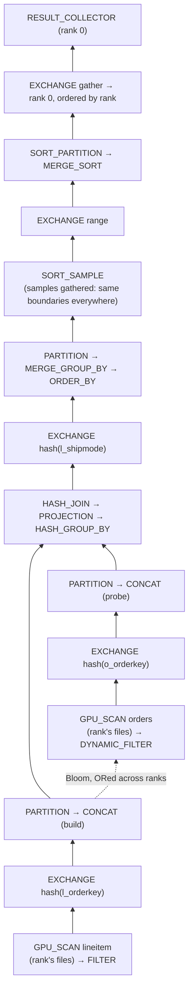

# Distributed Execution: the Exchange

Sirius can run one SQL query across several processes, one per GPU, on one host or several.
Every rank runs the same SQL. Each scans its own share of each table, and the plan moves rows
between ranks with two operators, `EXCHANGE_SINK` and `EXCHANGE_SOURCE`, over
[NIXL](https://github.com/ai-dynamo/nixl). Rank 0 returns the query's result.

```sql
LOAD 'build/release/extension/sirius/sirius.duckdb_extension';
SET enable_duckdb_fallback = false;
SET sirius_exchange_peers = '10.0.0.1:27000,10.0.0.2:27000,10.0.0.3:27000,10.0.0.4:27000';
SET sirius_exchange_rank = 2;            -- this process's position in the list
CREATE VIEW lineitem AS SELECT * FROM read_parquet('/data/tpch_sf1000/lineitem/*.parquet');
SELECT ...;                               -- the same statement on every rank
```

Without `sirius_exchange_peers`, nothing here applies and queries run in one process as before.

## Contents

- [How a query runs](#how-a-query-runs)
- [Layers](#layers)
- [The plan rewrite](#the-plan-rewrite)
- [Dynamic filters across ranks](#dynamic-filters-across-ranks)
- [Settings and build](#settings-and-build)
- [Running TPC-H Q12 on 4 GPUs](#running-tpc-h-q12-on-4-gpus)
- [Limits](#limits)
- [Tests](#tests)
- [Files](#files)

## How a query runs

TPC-H Q12 on 4 ranks: a join of `orders` and `lineitem`, a group-by on `l_shipmode`, and an
`ORDER BY`.



Each `EXCHANGE` box is an `EXCHANGE_SOURCE` whose child is an `EXCHANGE_SINK` of the same stream.
The sink ends its producer's pipeline; the source starts the consumer's.

## Layers

From the bottom up. Each layer is tested without the ones above it.

### Wire format (`src/exchange/wire.*`, `batch_io.*`)

A batch travels as one logical byte stream, cut into frames. Each column's buffers (null mask,
data, and for `STRING` the offsets child) sit at the offsets cuCascade's `column_metadata` gives,
256-byte aligned. That is the layout the host tier keeps its tables in, so one set of frames can
land on the GPU or in host blocks. The header (rows, stream bytes, column metadata) travels in
the first frame's notification and is checked before anything is allocated. Columns are
fixed-width or `STRING`.

- `outgoing_batch` holds a GPU batch read-only, so it cannot spill mid-send. It copies a sliced
  table first, and copies any stream range into a frame with one batched copy.
- `incoming_batch` lands a batch without waiting: on the GPU if a reservation is free now, else
  in host blocks, else it refuses. It then seals the frames into a GPU or host `data_batch`.

### Transport (`src/exchange/transport.*`, `messages.*`, `fabric.hpp`)

Each rank has a send ring and a receive ring. Both are fixed-size frames in one plain `cudaMalloc`
region, and they are the only memory NIXL registers. They are not pool memory: UCX `cuda_ipc`
cannot export stream-ordered allocations, and a pool block could be reused while a peer's write
into it is still landing.

- **Credits.** The receive ring is split evenly among the peers at start. A sender writes only
  into the frames it holds, and gets each one back once the receiver has copied it out. There is
  no lane set-up and no grant.
- **Landing.** With no room on the GPU or host, a batch's frames stay in the ring, holding their
  credits. That stops the peer until room appears.
- **End of stream** carries the batch count, so frames, ends and credits may arrive in any order.
  A frame that arrives before its batch's header waits for it.
- **Fail-stop.** A failed write, a malformed notification, a peer's error or a stall past the
  timeout calls `on_error` once and tells every peer.
- **Threading.** One engine thread owns the fabric, the rings' free lists and every landing. It
  polls CUDA events instead of synchronizing. A batch sent to the rank itself is handed over
  without a copy.

A `fabric` is what the transport needs from NIXL: one-sided writes into a peer's receive ring,
whose notification arrives only once the bytes have landed, plus plain notifications. Tests use
an in-process loopback fabric that can deliver notifications late and shuffled, and can fail
writes.

### NIXL fabric (`src/exchange/nixl_fabric.*`)

Each rank's NIXL agent serves its metadata from a listener thread on the rank's port. At start a
rank:

1. registers both rings with the UCX backend;
2. fetches every peer's metadata;
3. sends each peer a hello naming its receive ring's address, size and device.

It returns once every peer's metadata covers that ring. The listener serves metadata before the
rings are registered, so a peer fetched too early is fetched again. After the hello, everything
is a NIXL write or a notification. There is no TCP or RPC channel of our own. Between GPUs on one
host, UCX picks `cuda_ipc` zero-copy.

### Operators (`src/op/sirius_physical_exchange_{sink,source}.*`)

`EXCHANGE_SINK` routes by an `exchange_spec`:

| Mode | Routes | Notes |
|---|---|---|
| `hash` | by a hash of the key columns | PARTITION's key casts; its own seed, so PARTITION's split of each rank's share stays even |
| `range` | by the key columns against world − 1 boundaries | Input batches sorted on the keys; each rank's rows are one sorted run, cut at `lower_bound` as `SORT_PARTITION` cuts |
| `broadcast` | every row to every rank | |
| `gather` | every row to one rank | |

Finalizing the sink ends the stream to every rank that may receive it.

`EXCHANGE_SOURCE` starts a pipeline with what every expected sender sent:

- **Hint chaining.** Its child sink's pipeline wires a port into it that carries no data. While
  the source waits, its hint names that pipeline's head, so the task creator's walk reaches this
  rank's own scans.
- **Unordered,** each batch is a task on arrival.
- **Ordered,** nothing is released until every sender has ended. Then everything goes out as one
  task, by rank and then send order.
- A failed exchange is the exception of the source's next task.

`exchange_service` is one process's end of every exchange. It holds what arrives for a stream
before the stream's source is planned, and replays it when the source attaches.

### Collectives (`src/exchange/all_gather.*`)

`all_gather()` sends one small table from every rank to every rank and blocks until all have
arrived. It is used three ways:

- **`SORT_SAMPLE` in distributed mode.** Each rank shares up to 1024 evenly spaced rows of its
  sorted sample, and every rank merges them all in rank order. From the same global sample each
  rank derives the same world − 1 range boundaries for the exchange after it, and its own
  `SORT_PARTITION` boundaries from inside its range. A rank with no input still runs its boundary
  task (`runs_without_input()`), since the others wait for it.
- **The plan-shape check** (below).
- **The Bloom merge** (below).

## The plan rewrite

`distribute_plan()` (`src/planner/distributed_plan.cpp`) runs after
`insert_gpu_pipeline_operators()`. It walks the wrapped plan, tracks whether each subtree's rows
are spread across ranks, range-partitioned, or on rank 0, and puts an exchange where the
single-process plan already partitions:

| Plan shape | Exchange |
|---|---|
| `HASH_JOIN`, each side `CONCAT → PARTITION → input` | `hash` on that `PARTITION`'s join keys and casts, below it |
| `MERGE_GROUP_BY → PARTITION → HASH_GROUP_BY` | `hash` on the group keys, between `PARTITION` and `HASH_GROUP_BY` |
| `MERGE_AGGREGATE → UNGROUPED_AGGREGATE` | `gather` to rank 0, between them |
| `MERGE_SORT → SORT_PARTITION → SORT_SAMPLE → ORDER_BY` | `range` between `SORT_PARTITION` and a distributed `SORT_SAMPLE` |
| the result | `gather` to rank 0, ordered after a distributed sort |

`GPU_SCAN`, `FILTER`, `PROJECTION` and `DYNAMIC_FILTER` keep their input's placement. Anything else
is refused with `not_implemented_exception`: a nested-loop join, `TOP_N`, a CTE, a delim join,
`COUNT(DISTINCT)` partials, or a join over a gathered input. Running such an operator on each
rank's share would return a wrong answer.

- **Scan shares.** A table's local parquet files are laid end to end and cut into equal byte
  spans, one per rank (`byte_ranges_for_rank`). A rank reads the row groups whose start offset
  falls in its span ([`parquet_byte_range`](../../src/op/scan/parquet_byte_range.hpp)), so every
  row group is read once, and a one-file table still splits. A table of one row group lands on
  one rank. Remote files take no byte ranges: each rank keeps files `rank, rank + world, …`.
  Every rank binds every file, so DuckDB plans every rank from the same statistics.
- **Stream ids** come from the connection's distributed-query count, the same on every rank
  because every rank runs the same statements.
- **Plan-shape check.** Before running, every rank all-gathers a hash of its plan's shape, and
  every rank fails the query if any differs.

## Dynamic filters across ranks

After a join's exchange, a rank's build holds only its share of the keys, so a filter from it
alone would drop rows another rank's build matches. In distributed mode a publishing join
carries a `distributed_merge`. Every rank then:

1. builds a Bloom of one size for each key, from the plan's build estimate clamped to
   [2^16, 2^26] keys;
2. all-gathers it with a header (key rep, family, scale, size);
3. ORs the others into its own, and publishes it.

A key whose filters cannot all be merged publishes nothing: a rank sent none, a header differs,
or a rank missed the 2-minute wait. IN-lists and zone maps are not published in distributed mode,
nor are Blooms accumulated across a multi-partition build: the merge runs on whole-build
publication only. A rank with an empty build still merges, contributing an empty Bloom. A rank
that never saw a whole build joins each key's all-gather without a filter, so the others drop
that key at once instead of waiting out the timeout.
Filters stay optional and the join authoritative, so a missing filter costs speed, never
correctness.

## Settings and build

| Setting | Default | Description |
|---|---|---|
| `sirius_exchange_peers` | `''` | `host:port` of every rank's listener, comma-separated in rank order. Empty runs in one process. |
| `sirius_exchange_rank` | 0 | This process's position in `sirius_exchange_peers`. |

The exchange connects on the connection's first distributed query; the settings cannot change
after that. Set `enable_duckdb_fallback = false` on every rank: one rank falling back to the CPU
alone would return a wrong answer.

NIXL is an optional build dependency, linked from an out-of-tree install:

```bash
pixi run cmake --preset release -DSIRIUS_DUCKDB_SOURCE_DIR=$PWD/duckdb \
  -DSIRIUS_WITH_NIXL=ON -DSIRIUS_NIXL_PREFIX=$HOME/tools/nvda_nixl
pixi run make
```

Without it, a distributed query fails with "needs a Sirius built with -DSIRIUS_WITH_NIXL=ON".
`scripts/nixl_env.sh` sets the runtime paths:

- NIXL's libraries and its UCX ahead of the pixi environment's own UCX;
- `NIXL_PLUGIN_DIR`;
- `UCX_TLS=cuda_copy,cuda_ipc,tcp,self`.

## Running TPC-H Q12 on 4 GPUs

`scripts/exchange_sql_ranks.sh <ranks> <file.sql> [base port] [log dir]` runs a SQL file on N
local GPUs, rank i on GPU i, and prints rank 0's output. It prepends loading the extension,
`enable_duckdb_fallback = false` and the two exchange settings.

```bash
cat > /tmp/q12.sql <<'SQL'
create view lineitem as select * from read_parquet('/opt/sirius-ci/datasets/tpch_sf1000/lineitem/*.parquet');
create view orders as select * from read_parquet('/opt/sirius-ci/datasets/tpch_sf1000/orders/*.parquet');
.timer on
select l_shipmode,
  sum(case when o_orderpriority = '1-URGENT' or o_orderpriority = '2-HIGH' then 1 else 0 end) as high_line_count,
  sum(case when o_orderpriority <> '1-URGENT' and o_orderpriority <> '2-HIGH' then 1 else 0 end) as low_line_count
from orders, lineitem
where o_orderkey = l_orderkey and l_shipmode in ('MAIL', 'SHIP')
  and l_commitdate < l_receiptdate and l_shipdate < l_commitdate
  and l_receiptdate >= date '1994-01-01' and l_receiptdate < date '1995-01-01'
group by l_shipmode order by l_shipmode;
SQL
pixi run scripts/exchange_sql_ranks.sh 4 /tmp/q12.sql
```

Expected at SF1000: `MAIL 6233248 9344850` and `SHIP 6235412 9349394`, DuckDB's answer.

| 4 × GB200, Q12 SF1000 | First run | Warm run |
|---|---|---|
| Without the merged Bloom | 10.2 s | 6.55 s |
| With it (keeps 2.0% of `orders` before its exchange) | 10.0 s | 6.38 s |
| One GB200, one process | | 6.4 s |

The first run includes connecting NIXL to every peer. Q12 here is bound by the `lineitem` scan,
which every rank reads from the same shared storage, so 4 GPUs are no faster than one.

## Limits

- **Joins:** equality hash joins only. Nested-loop joins, delim joins, CTEs and `TOP_N` are
  refused rather than run per rank.
- **Remote files:** an S3 table needs at least as many files as there are ranks; local files
  split by byte range have no such limit.
- **Query start:** every rank must run the same statements in the same order, which is what
  numbers the exchanges' streams.
- **Unspillable buffers:** an unordered `EXCHANGE_SOURCE` queues arrivals in its port's
  repository, where they spill like any port's batches. Arrivals before the port is wired, an
  ordered gather's batches, and batches held for a stream not yet attached stay outside any
  repository and cannot spill. Sends block once a rank's queued sends exceed 1 GiB
  (`transport::options::max_queued_bytes`).
- **Blocking collectives:** `SORT_SAMPLE` and Bloom merges block a GPU worker thread until every
  rank's contribution arrives.
- **Failures:** a query that fails on one rank (an error, an exhausted retry) is aborted on every
  rank: the rank tells its peers (`exchange_service::abort`), and each fails that query's sources
  and all-gathers at once instead of waiting; the next query runs normally. A lost peer or a
  failed transport is fail-stop: every query fails, and nothing reconnects.
- **Credits:** each peer gets a fixed share of the receive ring (8 frames of 8 MiB by default).
  Clusters much larger than 8 ranks would need credits granted on demand.

## Tests

| Tag | Covers |
|---|---|
| `[exchange][wire]`, `[exchange][batch_io]` | Headers and refusals; batches through 64 KiB to 1 MiB frames to the GPU and host |
| `[exchange][transport]` | All-to-all on 3 and 4 ranks over the loopback fabric; one credit per peer; shuffled notifications; no room; failed writes |
| `[exchange][operators]` | Hash, range, broadcast, gather, ordered gather, early arrivals, hints, failure |
| `[exchange][byte_range]` | Byte spans tile every file exactly once across ranks; one file split in two; balance by bytes |
| `[exchange][collectives]` | All-gather; distributed `SORT_SAMPLE` on skewed and empty inputs; `SORT_SAMPLE` feeding a range exchange |
| `[exchange][nixl]` | Two ranks in one process over NIXL (NIXL builds only) |
| `[nixl_multiprocess]` (hidden) | One rank per process and GPU: `pixi run scripts/exchange_nixl_ranks.sh 4` |
| `[dynamic_filter][probe]` | Merging two Blooms of one capacity |

## Files

| File | Role |
|---|---|
| `src/exchange/wire.*`, `batch_io.*` | Batch layout on the wire; sending and landing a batch |
| `src/exchange/transport.*`, `messages.*` | Credits, landing, end of stream, failure |
| `src/exchange/fabric.*`, `nixl_fabric.*` | Rings; the NIXL fabric and its start-up |
| `src/exchange/exchange_service.*`, `exchange_runtime.*`, `all_gather.*` | A process's exchange; collectives |
| `src/op/sirius_physical_exchange_{sink,source}.*` | The operators |
| `src/op/sirius_physical_sort_sample.*` | Distributed sampling |
| `src/planner/distributed_plan.*` | The plan rewrite and plan-shape check |
| `src/op/dynamic_filter/dynamic_filter_publisher.cpp` | Bloom merge across ranks |
| `scripts/exchange_sql_ranks.sh`, `exchange_nixl_ranks.sh`, `nixl_env.sh` | Launchers and runtime paths |
