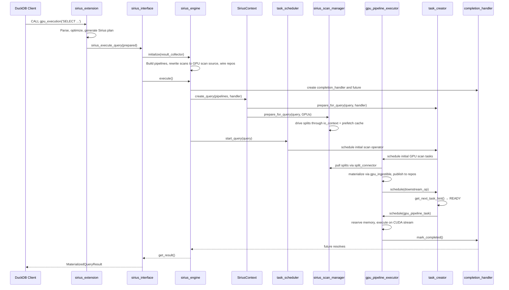

# Execution Flow

This document traces a Super Sirius query end-to-end, from SQL string to `QueryResult`, with file and line references.

## Entry Point

Users write plain SQL — transparent execution intercepts the query and routes it to the GPU:

```sql
SELECT * FROM lineitem WHERE l_quantity > 25;
```

The explicit `CALL gpu_execution('...')` function is also still supported.

## Step 1: Optimizer Extension Hook (Transparent Execution)

**Files:** `src/transparent/sirius_optimizer_extension.cpp`, `src/sirius_context.cpp`

DuckDB calls two Sirius optimizer hooks registered via `OptimizerExtension` — `sirius_pre_optimizer_hook` before optimization and `sirius_optimizer_hook` after — plus `SiriusContext::OnFinalizePrepare`. All three share one decision function, `should_use_duckdb` (`src/transparent/connection_provenance.cpp`), so provider-internal SQL and hidden catalogs are never intercepted: a connection carrying DuckLake's `ducklake_internal_connection` marker, or whose default catalog is hidden with `catalog_error_max_schemas = 0`, is classified provider-internal for its lifetime; a statement that reads or modifies a hidden catalog is excluded for the current planning attempt (the pre-optimizer hook classifies before optimization can remove the scans). Counters record provider-internal skips, hidden-catalog skips, and classification failures.

1. **Optimizer mask (at extension load, not per query)**: `IN_CLAUSE`, `COMPRESSED_MATERIALIZATION`, `LATE_MATERIALIZATION`, and the [shared aggregate and scan exclusions](../../src/planner/unsupported_optimizers.hpp) are unioned into `disabled_optimizers` once when the extension loads, because those can produce DuckDB-internal plan shapes the transparent rebind path cannot yet execute. `STATISTICS_PROPAGATION` remains enabled; its folded `EXPRESSION_GET`/`COLUMN_DATA_SCAN` and `DUMMY_SCAN` sources are translated to `GPU_VALUES`.

2. **Post-optimization** (`sirius_optimizer_hook`): Copies the optimized logical plan via `copy_logical_plan()` — `LogicalOperator::Copy()` plus restoration of what serialization drops: verified Parquet bind data and DuckDB's cardinality estimates — and stores it on the connection's per-connection state, stamped with the connection's current planning generation.

3. **OnFinalizePrepare** (`SiriusContext::OnFinalizePrepare`): After DuckDB generates its CPU physical plan, this hook:
   - Retrieves the stored logical plan copy
   - Calls `sirius_physical_plan_generator::create_plan()` — the single source of truth for GPU support
   - If successful, stashes DuckDB's CPU physical plan (kept for runtime fallback) and replaces `prepared.physical_plan` with a `PhysicalSiriusExecution` operator (a DuckDB `PhysicalOperator` subclass), handing it the validated Sirius plan together with the pin-registry epoch it was built under
   - If `create_plan()` throws (unsupported operator/type), the CPU plan is left in place — plan-time fallback. When `enable_duckdb_fallback` is false the error is surfaced instead of silently running on CPU.

4. DuckDB's executor runs `PhysicalSiriusExecution::GetData()`, which delegates to the Sirius GPU engine (Step 3 below).

## Step 1b: Explicit Table Function Path

**File:** `src/sirius_extension.cpp`

When using `CALL gpu_execution('SELECT ...')`, the flow is different:

1. `GPUExecutionBind()` re-parses the inner SQL, optimizes it, and generates the Sirius physical plan
2. `GPUExecutionFunction()` creates a `sirius_interface` and calls `sirius_execute_query()`
3. On failure (if fallback enabled), gracefully falls back to DuckDB CPU execution

This path is still supported but is no longer the primary way to use Sirius.

## Step 2: GPU Execution via PhysicalSiriusExecution

**File:** `src/transparent/physical_sirius_execution.cpp`

For transparent execution, DuckDB's executor calls `PhysicalSiriusExecution::GetData()` which lazily triggers the Sirius GPU engine on the first call. The first execution consumes the Sirius plan that `OnFinalizePrepare` built while validating GPU support (one-shot — the move empties the slot), provided the pinned-table registry epoch still matches the one the plan was built under; a pin or unpin landing in between discards it. When no validated plan is available — a re-execution of the same prepared operator, or a stale epoch — a fresh Sirius plan is rebuilt from the retained logical-plan template, or re-planned from the SQL string when the template cannot be copied. The operator then creates a `sirius_interface`, wraps the Sirius plan in a `sirius_prepared_statement_data`, and calls `sirius_execute_query()`.

If GPU execution fails at runtime (and `enable_duckdb_fallback` is true), the operator runs the stashed DuckDB CPU plan on a private `duckdb::Executor` bound to the same `ClientContext` — so the fallback executes under the same transaction and MVCC snapshot as the failed attempt, including that transaction's own uncommitted writes. The GPU result is fully materialized before any row is emitted, so the fallback cannot duplicate rows. S3-reading queries have no CPU path and surface a clear error instead of falling back. A `runtime_fallbacks` counter and a WARN log record each occurrence.

A replay that itself fails reports its own error, not the interrupt it raised: DuckDB's executors share cancellation state but not errors, so the failed nested executor would otherwise surface as `Interrupted` on the outer query. `run_cpu_fallback_plan` records the nested executor's error on the connection state, and the connection's `QueryEnd` replaces an INTERRUPT result error with the recorded one; a replay that was itself interrupted is not recorded, so a real user cancellation still reports `Interrupted`.

## Step 3: Query Lifecycle Setup

**File:** `src/sirius_interface.cpp`

`sirius_execute_query()` runs the query synchronously:

1. Creates the active query context (query text, `sirius_prepared_statement_data`, engine); `cleanup_internal()` resets it on exit
2. Binds the prepared statement with no parameters
3. Creates a `sirius_engine(context, query_id, query_label, session_label)` (the labels are optional telemetry names) and a `sirius_physical_materialized_collector` as the result sink
4. Calls `engine.initialize(collector)` to build pipelines (see Step 4)
5. Calls `engine.execute()` to run the GPU pipelines (see Step 5)
6. Calls `engine.get_result()` to detach the materialized result before the plan and executor are released

`SiriusBeginWindowFailureException` and `SiriusRuntimeUnavailableException` propagate unchanged to the caller's fallback routing; any other `std::exception` becomes an error-carrying `QueryResult`.

## Step 4: Pipeline Construction

**File:** `src/sirius_engine.cpp` — `initialize_internal()`

This is the core pipeline-building step (single-threaded, runs on the query thread):

### 4a. Build Meta-Pipelines

```
auto root = make_shared<sirius_meta_pipeline>(build_ctx, state, nullptr);
root->build(*sirius_physical_plan);  // Recursively builds pipeline graph
root->ready();                       // Reverses operator lists, marks pipelines ready
```

Each operator's `build_pipelines()` method is called recursively:
- **Streaming operators** (FILTER, PROJECTION): added as intermediate operators to the current pipeline
- **Blocking operators** (HASH_JOIN, ORDER_BY): become sinks, create child meta-pipelines for their build inputs
- **Source operators** (scans): set as pipeline source

### 4b. Operator-Specific Pipeline Splitting

The operator chains that drive the splitting are inserted at plan-generation time by the `wrap_*` helpers in `src/planner/sirius_physical_plan_generator.cpp` (see [Physical Plan Generation](physical-plan-generation.md)); `build_pipelines()` then cuts pipelines at the inserted boundaries:

- **TABLE_SCAN** → rewritten into a unified GPU scan source (`sirius_gpu_scan_operator`, type `GPU_SCAN`) with a per-table `gpu_ingestible`; the parquet table function maps to the parquet ingestible and `seq_scan` over a base table maps to the duckdb-native ingestible
- **HASH_JOIN** → inserts `PARTITION + CONCAT` on both probe and build sides
- **HASH_GROUP_BY** → inserts `PARTITION + MERGE_GROUP_BY`
- **UNGROUPED_AGGREGATE** → adds `MERGE_AGGREGATE` (no PARTITION; the merge collects partial aggregates)
- **ORDER_BY** → inserts the sort chain `ORDER_BY → SORT_SAMPLE → SORT_PARTITION → MERGE_SORT` (SORT_SAMPLE and SORT_PARTITION share one pipeline)
- **TOP_N** → adds `MERGE_TOP_N`
- **DELIM_JOIN** → complex splitting with partition_join and distinct branches

### 4c. Data Repository Wiring

`sirius_pipeline_converter::compute_repository_wiring()` records a `repository_wiring` descriptor for every cross-pipeline edge; `materialize_repository_wiring()` then creates the `shared_data_repository` instances (keyed by destination operator id and port id), attaches the ports, and configures barrier types:
- **FULL barrier**: downstream waits for upstream to complete (e.g., hash join build side)
- **PARTIAL barrier**: downstream can consume data incrementally
- **PIPELINE barrier**: streaming, no synchronization needed

### 4d. Pipeline Finalization

- Sinks are pushed into operator arrays
- Source references are set
- Parent-child dependencies are established
- Sibling partition operators are linked for hash joins
- The finalized pipeline list is stored in `new_scheduled`

## Step 5: Execution

**File:** `src/sirius_engine.cpp` — `execute()`

1. Creates this query's `completion_handler` and obtains its future
2. Calls `SiriusContext::create_query()` with the finalized pipelines and handler; query preparation makes the handler available to its pipeline tasks
3. Calls `task_scheduler::start_query(query)`, which schedules the initial scan operator
4. The main thread blocks on its future and validates completion before returning; an error drains in-flight work

## Step 6: Scan Execution

**Files:** `src/scan_manager/sirius_scan_manager.hpp`, `src/op/scan/sirius_gpu_scan_operator.cpp`, `src/io/io_context.cpp`

Scans run as a normal pipeline source on the GPU executor — there is no separate scan executor. Two cooperating pieces drive them:

1. **Scan manager (per-query setup + I/O).** During `prepare_for_query()`, `sirius_scan_manager` walks the query's scan operators in order. A cache miss gets a disk-reading `split_provider`; a pinned-cache hit is served by a cached batch provider in that query's coalescer slot. The per-query sequencer coalesces metadata, balances each split, and pushes it into the connector the operator created at plan time. The operator retains the ingestible the plan generator created.
2. **I/O layer.** The split providers read bytes through the scan manager's `io_context`: io_uring for local disk, with REST and kvikio backends resolved by per-backend path checkers via the datasource factory. The prefetching cache fronts the uring and REST backends.
3. **GPU scan source (materialization).** The unified `sirius_gpu_scan_operator` pulls splits from its `split_connector` (`get_next_task_input_data`) and, in `execute()`, delegates each split to the installed `gpu_ingestible`'s `materialize_table` (and conditional `post_filter_and_project`). This runs as a `gpu_pipeline_task` on a GPU executor worker thread and publishes GPU-ready batches to the data repository, scheduling downstream consumers via `task_creator->schedule()`.

## Step 7: GPU Pipeline Execution

**File:** `src/pipeline/gpu_pipeline_executor.cpp`

The GPU executor's manager loop:

1. **Acquire kiosk ticket** — blocks until a GPU worker is free
2. **Send task request** — signals the pipeline executor that it can accept work
3. **Pop task** — blocks until a `gpu_pipeline_task` is available
4. **Reserve memory** — acquires GPU memory reservation from `memory_space`
5. **Dispatch to worker thread** — on the thread pool with a CUDA stream:
   - Lock input batches and convert to GPU if needed (`lock_and_prepare_batch`)
   - `compute_task()`: iterate **all** operators in the pipeline (source through sink), calling `execute()` on each
   - `publish_output()`: call the sink's `sink()` method to push results to downstream ports
   - On OOM: catch `oom_reschedule_exception`, retry up to 100 times with 50ms backoff
   - On success: check if query is complete (RESULT_COLLECTOR sink + pipeline finished)
   - If not complete: schedule downstream consumers via `task_creator->schedule()`
   - If complete: `completion_handler->mark_completed()`

The GPU epilogue usually signals completion. A query-terminal pipeline also signals from
`sirius_pipeline::update_pipeline_status()`, covering finish transitions driven by other threads.

## Step 8: Task Creation Cycle

**File:** `src/creator/task_creator.cpp`

After a GPU task completes and schedules downstream operators:

1. The task creator receives `schedule(operator*)` calls
2. Its manager loop calls `get_operator_for_next_task(operator)` which:
   - Calls `operator->get_next_task_hint()` to check data availability
   - If `READY`: the operator has data — create a task
   - If `WAITING_FOR_INPUT_DATA`: recursively follow the producer chain
3. Creates a `gpu_pipeline_task` (including for the unified GPU scan source)
4. Dispatches it to the GPU executor

## Step 9: Result Extraction

**File:** `src/sirius_interface.cpp`

After the future resolves:

1. `sirius_execute_query()` calls `engine.get_result()`
2. The result collector (`sirius_physical_materialized_collector`) returns its `ColumnDataCollection`
3. The materialized result is wrapped in a `MaterializedQueryResult` and returned to DuckDB
4. `cleanup_internal()` releases the active query context (engine and prepared statement)

## Error Handling

If any task throws an exception during execution:

1. The GPU executor catches it and calls `completion_handler->report_error(exception)`
2. The query owner observes the error through its future and calls `SiriusContext::retire_query_work()`:
   - Closes the query's submission gate and waits for admitted publishers
   - Stops and joins that query's scan producers while retaining buffers
   - Discards that query's creator/scheduler queues and queued pool work
   - Leaves accepted GPU staging tasks for their managers to consume, preserving readiness
   - Waits for work leases before releasing query resources
3. The error surfaces as an error-carrying result at `PhysicalSiriusExecution::GetData()`.
   Shared pools and managers remain available for other queries.

On the transparent path, that error triggers the runtime CPU fallback described in Step 2 (unless `enable_duckdb_fallback` is false, the error is a user interrupt, or the query reads S3). The fallback runs the stashed DuckDB CPU plan in the same transaction, so a runtime GPU failure completes on CPU rather than failing the query.

## Sequence Diagram


