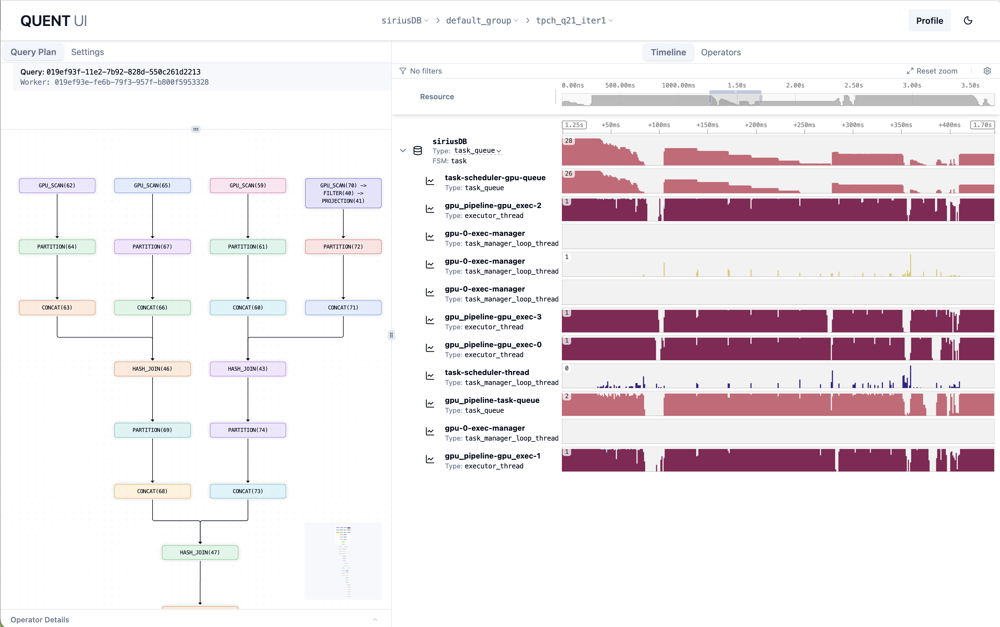
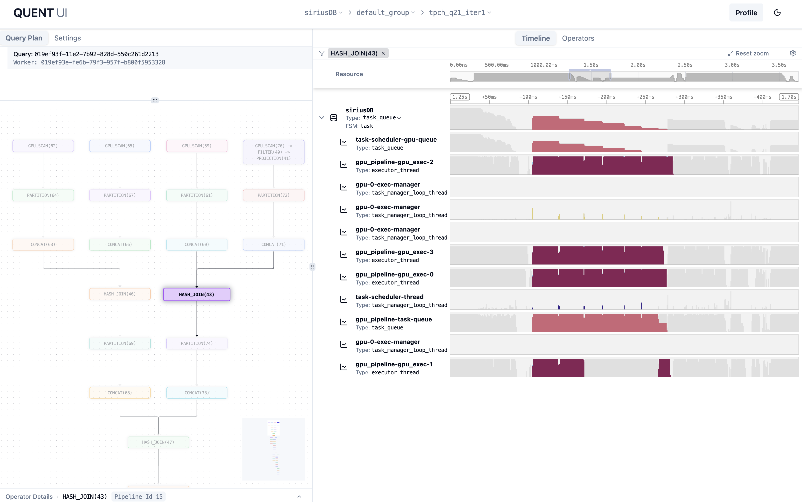
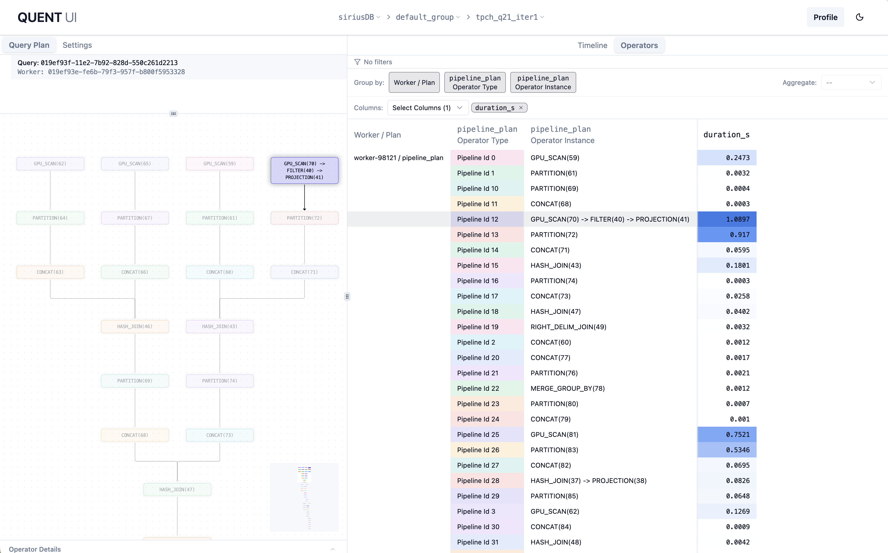

# Quent Telemetry & Tracing

> **Experimental.** Quent based instrumented telemetry is under active development and the emitted schema may change.

Sirius instruments query execution with [Quent](https://github.com/rapidsai/quent),
a modular instrumentation based telemetry toolkit to better understand runtime
behaviours of complex applications. When a query runs, Sirius emits structured
traces describing the engine, the plan (operators, ports, edges), executor
/task-manager threads, task queues, and per-query activity. These traces are written
as newline-delimited JSON (ndjson) files by default that Quent's analyzer server then ingests
and renders as an interactive timeline in your browser.

## 1. Enable the exporter

Telemetry is controlled entirely by the Sirius YAML config (see the
[Configuration reference](configuration.md#telemetry) for where config files are resolved). Enable
the Quent exporter and choose an output directory:

```yaml
sirius:
  telemetry:
    enable_quent: true
    output_directory: telemetry_data
    engine_name: siriusDB
```

| Key | Type | Default | Description |
|-----|------|---------|-------------|
| `enable_quent` | bool | `true` | Emit Quent telemetry using the configured exporter. When `false`, telemetry uses the no-op exporter and nothing is written. |
| `enable_nvtx` | bool | `false` | Capture NVTX ranges from Sirius and dependency images such as libcudf into Quent. No-op when `enable_quent` is `false`. |
| `exporter` | string | `ndjson` | Quent filesystem exporter; only `ndjson` is supported. |
| `output_directory` | non-empty string | `telemetry_data` | Directory for Quent telemetry files. |
| `engine_name` | non-empty string | `siriusDB` | Engine name reported in engine-level telemetry. |
| `nvtx_injection_lib` | string | empty | Optional NVTX injection-library override. Normally unnecessary: a loadable Sirius uses its own DSO, while a Sirius-enabled DuckDB executable resolves the initializer from itself. `NVTX_INJECTION64_PATH` takes precedence. Used only when `enable_nvtx` is `true`. |

With `enable_nvtx: true`, Quent captures NVTX emitted by dependency images such as libcudf in both deployment modes. A
loadable Sirius is its own injection DSO. A DuckDB executable with Sirius linked into it exports the
same initializer and handles NVTX's private injection token inside the executable, so it does not
ship a sidecar DSO.

Load the config through the normal resolution path — usually by setting
`SIRIUS_CONFIG_FILE=/path/to/sirius.yaml` before loading the extension. Any Sirius query run with
`enable_quent: true` then writes ndjson files into `output_directory` as NDJSON.

## 2. Label your queries (optional)

Per-query labels are configured separately from the YAML config and make individual queries easy to find while analyzing multiple queries. A label can be set with the `sirius_set_query_label` SQL function or inline with
the `query_label` named parameter on `gpu_execution(...)`:

```sql
-- Applies to the next Sirius query, including transparent plain-SQL execution.
CALL sirius_set_query_label('tpch_q1_iter1');
SELECT * FROM lineitem WHERE l_orderkey < 100;

-- Inline label for an explicit gpu_execution call.
CALL gpu_execution(
  'SELECT * FROM lineitem WHERE l_orderkey < 100',
  query_label = 'tpch_q1_iter1'
);
```

`sirius_set_query_label` is consumed once by the very next Sirius query. For an explicit
`gpu_execution(...)` call, an inline `query_label` parameter takes precedence over a pending label set
with `sirius_set_query_label`. Unlabeled queries are reported as `unnamed_query`.

### Query lifecycle metadata

The query UUID identifies one observation. `Init`, `Planning`, `Executing`, and
`Finished` remain its lifecycle transitions. Completion is read from `Finished`
explicitly, including `Init -> Finished` and `Planning -> Finished`; completion
alone does not imply success. The pinned FSM analyzer still omits truncated or
invalid lifecycles with a warning, rather than synthesizing a terminal event.

`QueryDetails.update` carries a query reference, a positive revision, and a complete
`QueryMetadata` snapshot. One observer owns this metadata stream; its revision and
handle survive moves. The analyzer selects the highest revision, independently of
file/arrival ordering and lifecycle timestamps. Metadata may arrive after `Finished`
without extending the query duration. Duplicate/older revisions are ignored. Mixing
metadata streams for one query is rejected.

The optional fields are `instance_name`, `connection_id`, `query_ordinal`,
`planning_generation`, `execution_query_id`, `worker_id`, `disposition`, and `outcome`.
Snapshots replace previous metadata rather than patching it, so producers must
include all currently known fields. An absent execution ID remains unknown; no
runtime window is invented for a query that never executes. An absent late name
retains the name from `Init`. Correlation and outcome appear in the query's custom
attributes, preserving numeric IDs as unsigned integers.

Disposition describes the path (`cpu_only`, `gpu`, `gpu_to_cpu`); outcome describes
the outer invocation (`success`, `failed`, `cancelled`, `abandoned`). These are
independent, extensible string vocabularies. In particular, a failed GPU attempt
followed by successful CPU replay has disposition `gpu_to_cpu` and outcome
`success`. Existing traces lacking metadata retain their initial name/group and
have unknown correlation, disposition, and outcome.

The pinned Quent viewer requires a root plan. For a query with no stored plan,
Sirius adds a deterministic, empty **presentation-only** plan to `QueryBundle`,
labelled `No execution plan - query lifecycle only`. Its query has the custom
attribute `plan_representation=query_lifecycle_placeholder`. This placeholder is
absent from the trace and analyzed model; it has no worker, edges, operators, tasks,
or execution window. Nonempty execution plans still pass normal plan-tree
validation. This preserves the pinned viewer response shape without claiming GPU
execution. The pinned single-plan picker displays the plan UUID with a generic
`Query:` prefix.

This schema/projection support does **not** enable observation at DuckDB query
begin yet. Current producer boundaries and label consumption stay unchanged:

- Transparent SQL consumes a pending label in the GPU wrapper's
  `GetGlobalSourceState`; explicit `gpu_execution` consumes it during binding.
- An explicit inline label takes precedence, while still consuming the pending
  label at the existing explicit-bind boundary.
- Ordinary CPU statements, SET, and label-setting statements do not consume a
  pending label. The session label is sticky.
- When early observation is introduced, select the initial query group from the
  session-label snapshot at the outer `QueryBegin`. Freeze that group for the
  invocation; session-label changes within the statement affect later invocations.
  Observing a statement must not itself consume a pending query label. Attach a
  late label to the existing UUID when the existing consumption boundary is reached.

The existing lifecycle event payloads are unchanged. Producers emitting the new
`QueryDetails` entity require this schema-aware analyzer; older analyzers cannot
import those records. Use matching Sirius producer/analyzer revisions for new
captures and the Quent revision pinned by their `model.qmi`. No Quent dependency
update is required for the presentation placeholder.

## 3. Generate telemetry

Run any query with the exporter enabled and telemetry files appear under `output_directory`.

### TPC-H helper

For TPC-H Parquet runs, `run_tpch_parquet_and_generate_telemetry.sh` runs the queries, labels each
`(query, iteration)` pair with `sirius_set_query_label` before executing it, and writes the Quent
files to `sirius.telemetry.output_directory`:

```bash
pixi run -- ./test/tpch_performance/run_tpch_parquet_and_generate_telemetry.sh \
  --iterations 1 \
  --parquet-dir /data/tpch/sf100/p16/zstd-8/ \
  100
```

The trailing `100` is the TPC-H scale factor. If no query numbers are provided, all 22 queries are
run; append query numbers to limit the run, e.g. `100 1 6 9`.

The script uses `test/tpch_performance/tpch_telemetry_sirius.yaml` by default, which only enables
telemetry. Pass `--config <path>` when the workload also needs custom memory, executor,
scan-cache, or operator settings:

```bash
pixi run -- ./test/tpch_performance/run_tpch_parquet_and_generate_telemetry.sh \
  --config ~/.sirius/sirius.yaml \
  --iterations 1 \
  --parquet-dir /data/tpch/sf100/p16/zstd-8/ \
  100 1 6 9
```

See [TPC-H Performance Testing](../../test/tpch_performance/run.md) for the full benchmarking
workflow.

## 4. Visualize

Start the Quent analyzer server over the telemetry directory. The `quent` Pixi task runs the
telemetry server with the UI enabled and defaults to `./telemetry_data` as the telemetry data directory:

```bash
pixi run quent                          # serves Quent UI, reading data from /telemetry_data
pixi run quent /path/to/telemetry_data  # if you used a different output_directory
```

Then open Quent UI at `http://localhost:8080` and select the captured Sirius engine/query to explore its
timeline.

## Example Screenshots

**Default view** — the query plan on the left and the per-resource execution timeline
(executor threads, task-manager loops, task queues) on the right.

Resources are grouped into a collapsible tree by GPU device: each `gpu-N` group (declared once per
GPU at engine startup) contains per-thread-type buckets (`executor_thread`,
`task_manager_loop_thread`) plus that executor's task queue, and a `shared` group under the engine
holds threads with no single GPU (e.g. the task-scheduler thread). The tree shape is entirely
data-driven via each resource's `parent_group_id`; to inspect it offline run:

```bash
pixi run bash -c "cd rust && cargo run -p sirius-telemetry-analyzer --example print_resource_tree -- <output_dir>/<session_uuid>"
```



**Operator timeline** — selecting an operator or pipeline highlights it in both the plan and the
timeline, so you can see exactly when and where it ran across the resources.



**Operator stats** — the Operators tab tabulates per-operator/per-pipeline statistics (e.g.
duration), grouped and sortable, to, for example, quickly find the most expensive operators in the query.


